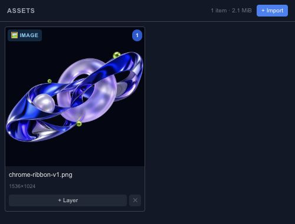

# Import images, SVG, GIF and sprite sheets

Choose an import method according to the source. A still image is one visual resource; an animated GIF contains frames; an SVG can describe editable vector geometry. These formats should not be expected to produce identical kinds of layers.

## Files, URLs and clipboard

The editor supports file import, URL import and supported clipboard content. Start with a local file when diagnosing a problem. URL imports also depend on whether the source server permits the browser to read the resource.

Images, video and audio become media resources with corresponding layer workflows. GIF decoding is supported through import even though the separate GIF shortcut in the Add panel is marked as coming soon.

## SVG and sprite sheets

SVG import converts supported content into scene geometry and reports limitations. Inspect text, masks, transforms and effects rather than assuming a complex illustration is preserved perfectly.

A sprite sheet places animation frames in one image. Use the sprite-sheet import flow to describe its frame layout and timing, then preview the sequence. Check the first and last frame so a wrong cell size does not create a jump or crop.

## Lottie and project JSON

Lottie import currently retains the file and its metadata as an asset. It is not a native keyframe conversion. Open a Chorono project JSON when you need to recover editable Chorono layers and timelines. Keep the original source file whenever conversion may lose information.
