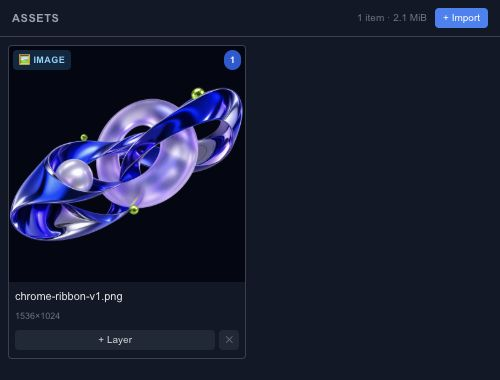

# Manage the assets used by a scene

The Assets panel holds the media used by the project. Import a file once, then use the asset in the scene where the format supports it. Give the resulting layer a name that describes its role, such as Background photo or Button sound.

## Import and place

Use the import control to choose files. Image, video and audio layers have different playback and sizing controls, so inspect Properties after adding them. A file appearing in the asset list does not mean every detail of its original format has become editable layers.

For SVG, GIF, sprite sheets and URL-based import, read [Import formats](editor-assets-import.md) before choosing a workflow. In particular, importing a Lottie file currently preserves it as an asset; it does not reconstruct its animation as native Chorono tracks.

## Keep a portable project

Save an editable project and reopen it to check that its media still loads. A temporary browser URL is not a portable file reference. Review export warnings when a file cannot be embedded or loaded.

The [Resources](editor-resources.md) panel helps identify large images, video frames and other tracked resources. Use it to find the media worth optimizing, while keeping the original files available outside the project.
