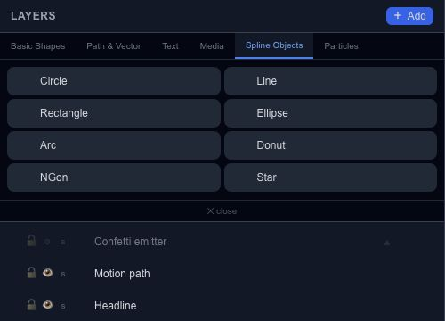

# Compound paths and vector Boolean operations

A compound path groups multiple contours into one editable vector object. A closed contour inside another can form a hole. Drawing and continuing contours are available in v0.4. The **Compound Path**, Boolean and mesh conversion controls described below are available in the 2D geometry development build.

## Draw and append spline contours

Start with a primitive from **Layers → Add → Spline Objects**. The **Donut** gives you an outer contour and an inner hole in one layer.

In v0.4, select an eligible spline before adding another primitive. Right-click an open endpoint and choose **Continue spline** to extend it. Use **Add line to spline** to add a separate contour, or **Draw new spline line** to create a new layer. Press **Enter** or right-click to finish an open line, or click near its other end to close it.

In the development build, select the spline and expand **Draw new spline elements** in **Edit**. To continue an open contour, choose its endpoint in **Point** mode and click **Continue selected endpoint**. **Auto Close** closes a line when its last point snaps to the first.

In **Object** mode, each element can contain several contours. A donut, for example, has one element with an outer contour and an inner hole. Use [Point or Edge mode](editor-canvas-splines.md#select-points-edges-or-objects) to edit a single part of its boundary.

## Make a compound path with a hole

1. Create two closed contours in the same spline layer, with the smaller contour inside the larger one.
2. Press **3** to enter **Object** mode. Select the two elements and choose **Compound Path** under **Spline Boolean & Paths**.
3. Set a fill in **Properties** and check the hole. **Compound Path** sets the layer's fill rule to **Even-odd**, which also applies to any unselected contours on the same layer.

Use **Separate Paths** to split disconnected regions into editable elements. Each hole stays with its enclosing contour.

## Combine shapes with Boolean operations

| Operation | Result |
| --- | --- |
| Union | The area covered by any input |
| Subtract | One input with the overlapping area cut away. Check the A/B order in the preview. |
| Intersect | The area shared by the inputs |
| XOR / Exclude | The area covered by an odd number of inputs |

Select two to eight closed shapes, splines or spline objects and open **Preview Boolean** in **Edit**. Check the highlighted area, the subtraction order and the curve tolerance before choosing **Apply Boolean**. This preview workflow stores the inputs in an operation group. **Merge Paths** turns that operation into editable spline contours. **Separate Inputs** restores the original inputs.

The direct Boolean buttons in spline **Object** mode produce an editable spline by default. Enable **Non-Destructive** when you want to retain the inputs and recalculate the result after editing a source. Boolean boundaries are sampled at a tolerance. For an arrangement that only needs an even-odd fill, **Compound Path** keeps the original Bézier segments.

## Convert a shape to a spline or 2D mesh

Select a supported Basic Shape or spline and open **Convert** from the canvas context menu. **Convert Spline** turns a Basic Shape into point-editable geometry. **Convert 2D Mesh** triangulates the filled region of supported closed geometry. For a multiselection, Chorono unions the closed inputs first and retains holes and disconnected regions in the result.

The conversion appears in the **Edit** stack. Use **Source → Rebuild from source** when you intend to regenerate from the original parameters, since this replaces point edits made to the converted spline. See [spline modifiers and Bake](editor-canvas-spline-modeling.md#use-the-spline-modifier-stack) for working with generated geometry.
