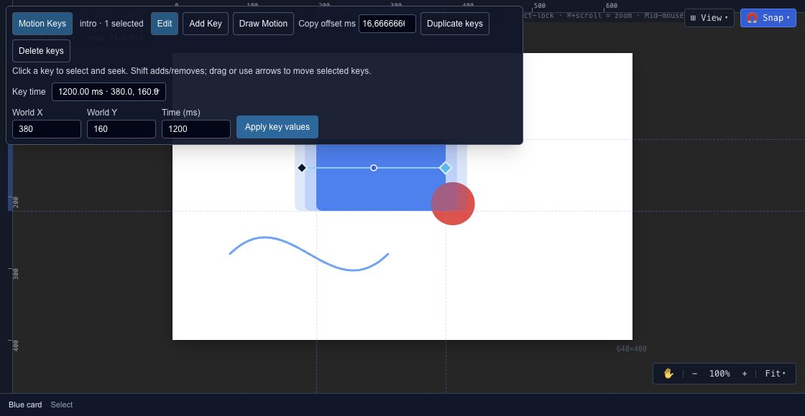

# Edit animation positions on the canvas

Motion Keys bring position editing onto the canvas. They are useful when the movement looks wrong spatially even though its timing looks reasonable in the timeline.

## Edit an existing movement

Select an animated layer and its timeline, then enable **Motion Keys**. Use **Edit** to select a position key or **Add Key** to add a new one. The selected-key inspector lets you edit world X/Y and the key's time in milliseconds.

Use **Duplicate keys** with an explicit time offset when a position should recur later. A spatial point and a key time are separate decisions: moving a point changes the route; changing its time changes when the layer gets there.

## Draw a movement

Choose **Draw Motion** and set the start/end times. **Equal time** distributes the samples evenly in time; **By distance** uses spacing along the drawing. Choose **Append** to retain existing keys and reject collisions, or **Replace start–end range** when replacing that part of the movement is intentional.

Play the result, then compare its speed in [Curve Editor](editor-timeline-curves.md). Drawing a pleasing path does not automatically produce the timing you want.
