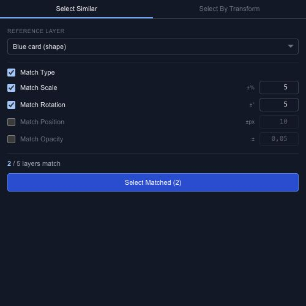

# Select exactly the objects you need

When several objects overlap, clicking each one can become the slowest part of an edit. Chorono offers shape-based selection on the canvas and a separate **Select** panel for finding matching layers.

## Select an area

Use **Box**, **Lasso**, **Circle** or **Paint Select**. **Inside** requires the object bounds to fit inside the selection area. **Touching** also includes objects that overlap its edge. Change that setting when a nearly enclosed object keeps getting missed.

## Find similar layers

In the Select panel, choose a reference layer and open **Select Similar**. Match its type, scale, rotation, position or opacity. Use only the criteria that matter: matching both position and type is much narrower than matching type alone.

**Select By Transform** lets you build numeric or text rules. Review the selection before applying a shared edit, especially in a scene containing hidden layers.

For a multi-selection, choose **Selection center** or **Active object** as the pivot. That choice changes where a group rotation or scale is centered; it does not create a group in the layer hierarchy.
