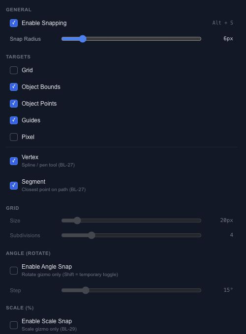

# Align objects with guides and snapping

Snapping helps a dragged object settle on an exact target. Start with the targets you need for the current task; enabling every target can make a crowded scene harder to position.

## Choose targets

Open **Snap** on the canvas for the common switches, or restore the Snap panel from the File menu for the full controls.

| Setting | What it changes |
| --- | --- |
| Object Bounds / Points | Alignment to other objects and their reference points. |
| Guides / Grid / Pixel | Placement against guides, grid lines or whole pixels. |
| Vertex / Segment | Alignment to spline points or the nearest point along a path. |
| Snap Radius | How close a drag must get before a target attracts it. |
| Angle / Scale | Stepped rotation or percentage scaling. |

## Set up a simple grid

Enable Grid, choose its size and subdivisions, then move two shapes onto neighboring cells. If a different object keeps attracting the selection, temporarily switch off Object Bounds.

The canvas **View** menu controls rulers, guide visibility, grid drawing order and selection gaps. Hiding a guide is a viewing decision; check Snap settings separately when you want to stop snapping to it.
