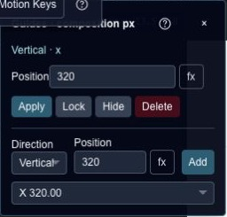

# Align objects with guides and snapping

Snapping helps a dragged object settle on an exact target. Start with the targets you need for the current task; enabling every target can make a crowded scene harder to position.

## Choose targets

Open **Snap** on the canvas for the common switches, or restore the Snap panel from the File menu for the full controls.

| Setting | What it changes |
| --- | --- |
| Object Bounds / Points | Alignment to other objects and their reference points. |
| Guides / Grid / Pixel | Placement against guides, grid lines or whole pixels. |
| Vertex / Segment | Alignment to spline points or the nearest point along a path. |
| Snap Radius | How close a drag must get before a target attracts it. |
| Angle / Scale | Stepped rotation or percentage scaling. |

## Set up a simple grid

Enable Grid, choose its size and subdivisions, then move two shapes onto neighboring cells. If a different object keeps attracting the selection, temporarily switch off Object Bounds.

The canvas **View** menu controls rulers, guide visibility, grid drawing order and selection gaps. Hiding a guide is a viewing decision; check Snap settings separately when you want to stop snapping to it.

## Add and edit ruler guides

Drag a guide from a ruler or open **Guide controls** to add one numerically. Positions are composition pixels: vertical guides use X, horizontal guides use Y. Select a guide, type its position and choose **Apply**. Lock protects a guide from movement; Hide keeps it in the project without showing it; Delete removes it.

For a guide halfway across a 1920-pixel composition, use **Calculate once** with `1920 / 2`, then apply 960. The calculation does not become a live formula. Rulers, guides and cursor measurement lines are editing aids and do not appear in export.

## Measure and edit selection gaps

Select neighboring objects to see horizontal or vertical edge-to-edge gaps. These measurements describe aligned neighbors, not every diagonal distance in the selection.

Click a gap label to open **Edit selection gap**. Check the named **Fixed** and **Moving** objects, enter the distance in composition pixels and choose **Apply**. Negative values create overlap. Only the identified moving object changes; other selected objects are not automatically redistributed. Apply is one Undo step, and Escape cancels.
