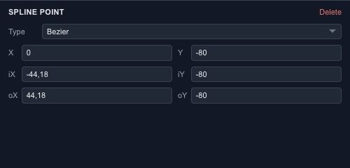

# Edit Bézier points and spline curves

A 2D spline is an editable vector path made of straight and curved segments. Anchors mark where the segments meet. Bézier handles control the direction and shape of a curve between anchors. Use a spline when you need to refine an icon outline, a curved stroke or another shape point by point.

## Start with a shape or a path

Open **Layers → Add → Spline Objects** for circle, line, rectangle, ellipse, arc, donut, NGon and star primitives. Use the spline drawing tool to start a line or append to an eligible spline. See [drawing and continuing contours](editor-canvas-compound-splines.md#draw-and-append-spline-contours) for the steps in each editor version.

## Select points, edges or objects

These modes are available in the 2D geometry development build. In v0.4, select a spline point on the canvas and use the **Spline Point** inspector below.

In the development build, select a spline layer and press **1** for **Point**, **2** for **Edge** or **3** for **Object** when the canvas has focus. The **Edit** dock also offers those three modes. Click **Done** to return to layer tools.

| Mode | Select | Common edits |
| --- | --- | --- |
| Point | An anchor or its Bézier handles | Move an anchor, change its type, copy or reset tangents, break or weld eligible points |
| Edge | One or more segments between anchors | Switch between line and cubic, insert a vertex, refine or divide a segment, split, trim or extend where the selection permits |
| Object | A complete element, including its contours and holes | Close or reverse contours, simplify, smooth, subdivide or change interpolation |

Expand **Selection actions** and the mode-specific sections in **Edit** to find the available tools. To move, rotate or scale a selection, choose **Scene** or **Local** axes in the viewport. These transforms change the selected geometry around the layer's existing origin. Each completed move, rotation or scale can be undone.

## Adjust a point

Enter point editing and select a point. Its inspector exposes **X/Y** and the incoming and outgoing handle coordinates. **Corner**, **Smooth**, **Bézier** and **Bézier Corner** offer different corner and handle behavior.

Move the point to change the outline. Move a handle to change how the curve approaches or leaves that point. Start with a small handle adjustment: a long handle can affect much more of the curve than expected.

A cubic Bézier segment has two endpoints and two controls. In a Bézier spline, several segments meet at shared anchors, so you can shape successive parts of the path. At a smooth join the incoming and outgoing directions line up. Use a corner point when the direction should change abruptly.

## Extend and finish

Use point and segment [snapping](editor-canvas-snapping.md) to place an endpoint precisely. To extend an open contour, select its endpoint. The development build also lets you close a contour in **Object** mode. New splines in that build start with **No Fill** and a black 3 px stroke.

For holes or several contours in one layer, see [compound paths and vector Boolean operations](editor-canvas-compound-splines.md). For offsetting a contour, rounding corners or converting a stroke into a filled outline, see [2D spline modeling](editor-canvas-spline-modeling.md).
