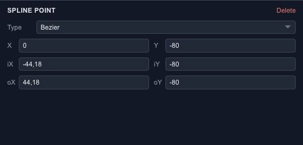

# Edit Bézier points and spline curves

A curve is easier to control when you can see the points that define it. Use a spline for artwork that needs point-by-point editing, such as a custom icon outline or a curved stroke.

## Start with a shape or a path

Open **Layers → Add → Spline Objects** for circle, line, rectangle, ellipse, arc, donut, NGon and star primitives. You can also draw a path with the Pen tool. **Convert to Spline** is available for supported shape and text selections; keep a copy if you want to retain the original editable text.

## Adjust a point

Enter point editing and select a point. Its inspector exposes **X/Y** and the incoming and outgoing handle coordinates. **Corner**, **Smooth**, **Bézier** and **Bézier Corner** offer different corner and handle behavior.

Move the point to change the outline. Move a handle to change how the curve approaches or leaves that point. Start with a small handle adjustment: a long handle can affect much more of the curve than expected.

## Extend and finish

Use the spline creation controls to start a new spline or append to a compatible selection. Check whether the contour should be open or closed before adding a fill. Point and segment snapping help join the intended locations without relying on zoom alone.
