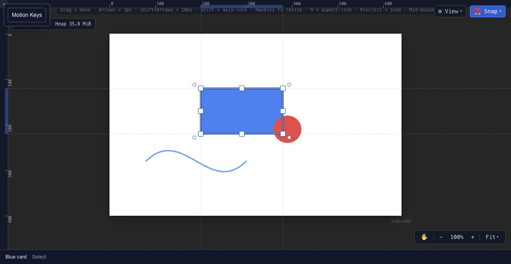

# Canvas and drawing tools

Use the canvas to arrange the objects in your composition. The visible workspace can be zoomed and panned without changing the exported composition dimensions.

## Navigate the composition

Use the hand tool to pan and the zoom controls to inspect details. Fit brings the composition back into view. Position and size properties describe the scene's coordinates, rather than the size at which the editor happens to display it.

Use the select tool to pick an object, then adjust it with its transform handles or the [Properties panel](editor-properties.md). When objects overlap, select the intended named object from [Layers](editor-layers.md).

## Draw shapes and splines

Create a shape from the toolbar and place it in the composition. Use the spline tools for editable paths. **New Spline** starts a separate path; **Append** extends an eligible existing spline. Select the intended spline before extending it.

Keep drawing and selection separate: if a click starts creating another object, return to the select tool. Name new layers in the hierarchy as soon as their role is clear.

## Align and inspect motion

The canvas provides snapping and guide controls for placement. Check the **Snap** setting when a drag lands on a guide or nearby feature. Use exact property values when a layout needs a specific coordinate.

**Motion Keys** exposes viewport controls for supported position animation. It complements the timeline; the timeline remains the place to inspect key times, property tracks and easing. Select the appropriate animation and layer before editing a motion key.

## Check before exporting

Scrub the [timeline](editor-timeline.md) to inspect the beginning, a middle frame and the end. Confirm that moving objects stay inside the intended composition and that text remains readable at the delivery size. Canvas zoom does not set the resolution of an [image export](export-images.md).
