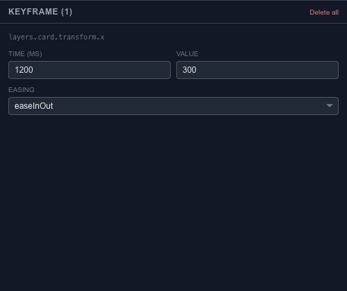

# Edit a keyframe’s time, value and easing

Select a keyframe to inspect the exact time and value behind its position in the timeline. The inspector is useful when a card must reach a precise coordinate or a fade must finish at a particular time.

## Change one value deliberately

Set the key's time in milliseconds, then adjust its value in the property's units. Position uses coordinates, rotation uses degrees and opacity uses a normalized value. Check the selected track before typing; the same number has a different meaning on each property.

Commit the edit and scrub through the neighboring keys. Undo restores the previous value if the change moves the animation away from what you intended.

## Pick an easing

Choose linear for a steady transition, hold for a stepped change, or an ease-in/ease-out option for acceleration or deceleration. Custom Bézier easing is available when you need a more specific curve. The easing belongs to the transition associated with that key, so inspect the segment after changing it.

For a group of numeric edits, open the [Keyframe Spreadsheet](editor-keyframes-spreadsheet.md). For adjusting the feel visually, use the [Curve Editor](editor-timeline-curves.md).
