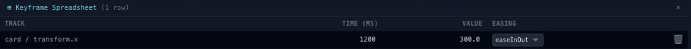

# Edit selected keyframes in a table

Open **Sheet** from the timeline toolbar after selecting one or more keys. The spreadsheet puts their track names, times, values and easing choices in one place.

## Edit a cell

Click a time or value cell, type the new number and press Enter to commit. Escape cancels the current edit. Use the easing selector to change interpolation for a row. Non-numeric values are shown without pretending they can be edited as numbers.

Keep units in mind: a time is in milliseconds, while the value belongs to its property. Changing the time of a single key can change the duration of an action, so preview after the edit.

## Compare several keys

Select the keys at the end of several entrances to see whether they finish together. For a stagger, give each entrance a deliberate offset rather than estimating every gap from screen pixels.

The table edits the same source keys as the Timeline and Curve Editor. Closing it does not discard committed changes. Use Undo for an edit you want to reverse, or return to [Timing operations](editor-keyframes-timing.md) for changes that affect a whole selection.
