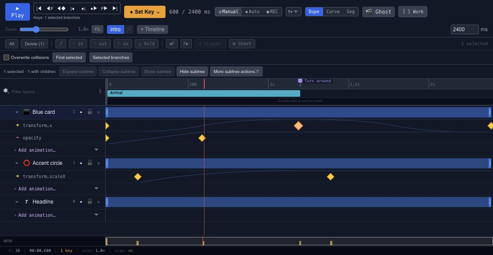

# Retiming and staggering keyframes

A stagger offsets similar actions so they happen in sequence. It is useful for a row of cards, a set of dots or a heading whose parts arrive one after another.

## Move or stretch

Moving a group of keys preserves their spacing. Moving only the ending keys changes the duration. Decide which operation you need before dragging, then check that the selection includes all the properties belonging to the action.

Use the available stagger and timing controls for a consistent interval. Start with a small delay and preview the whole sequence. Too much stagger can make the last object feel disconnected from the first.

## Repeat outside the keys

Track out-of-range behavior determines what happens before the first key or after the last. Constant holds a boundary value; repeating and ping-pong modes reuse the motion in different ways. Relative repeat adds the cycle's value change, while linear continuation extends the direction of travel.

These track choices are separate from timeline looping. Check both when motion repeats unexpectedly. For a repeating composition, keep the final-to-first transition in view and follow the [Looping animations](loop-animation.md) guide.

## Retime keys without accidental collisions

Move, slide, scale, stagger, paste and spreadsheet edits are reviewed as a group. By default, a move that would place keys on an occupied time in the same channel is rejected as a whole. A timeline boundary also preserves the group's spacing rather than clamping each key separately.

Use **Overwrite collisions** only when you intend to replace existing, unselected keys at the destination. It never merges two selected keys into one key on the same channel and time. Check the affected channels, apply, then play across both ends of the edited interval. Undo returns the group to its previous state.

Timing changes and [keyframe interpolation](editor-timeline-curves.md) answer different questions: timing says when a key happens, while interpolation shapes the movement between keys. For controller-generated motion, [bake the track](editor-timeline-controllers.md#bake-a-property-track-to-keyframes) before editing it as native keys.
