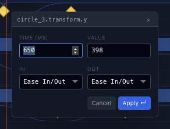
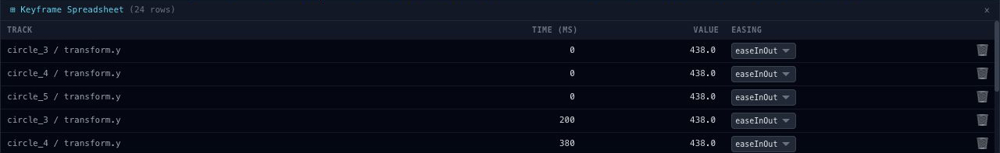
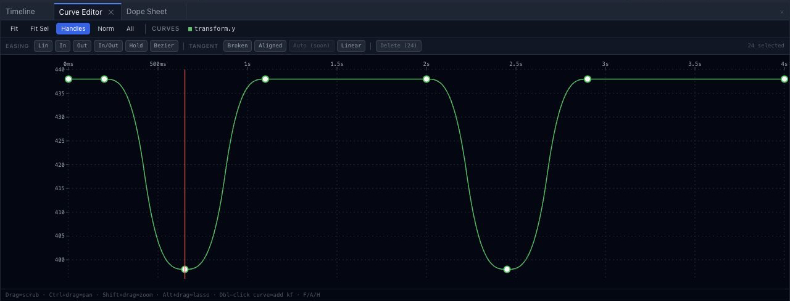

# Edit keyframes in Chorono

A keyframe records a property value at a specific time. Change the value or its time to revise the motion while keeping the scene's objects editable.

## Open an editable example

Complete [Your first animation](getting-started.md) or download the project from [the loop tutorial](loop-animation.md). Work in a separate editor tab and save a copy before experimenting.

## Find the right property track

Select the layer you want to change, then inspect its animation tracks. A layer can have separate tracks for vertical position, horizontal position and opacity. Check the layer name and property before editing a keyframe.

Use [Timeline and playback](editor-timeline.md) to compare the selected track with the scene's playhead and frame rate.

The loop example's **Left dot** has a `transform.y` track. At 650 ms the stored value is 398. At 1100 ms it is 438. In composition coordinates, smaller y values move the dot upward.

## Change a keyframe value

Select the peak keyframe at 650 ms on **Left dot** and inspect its value. Change y from 398 to 418 while keeping its resting value at 438.

This reduces the upward movement from 40 pixels to 20 pixels.

Play the animation and inspect the result. The example has a second peak at 2450 ms; change it too if you want both waves to use the smaller movement. The [loop tutorial](loop-animation.md) gives the exact values for the other dots.

## Edit selected keys in the spreadsheet

Select one or more keyframes in **Timeline**, then choose **Sheet** in its keyframe toolbar. The **Keyframe Spreadsheet** appears below the tracks and lists **Track**, **Time (ms)**, **Value** and **Easing** for the selected keys.

Choose a numeric cell to edit it and press **Enter** to commit. Changing **Time** changes when the key is reached; changing **Value** changes its stored property value. Keep these separate when reducing the dot's movement. Close the spreadsheet to return space to the tracks.

## Separate timing from easing

Moving a keyframe in time changes when the stored value is reached. Changing easing changes the progress between stored values. In Chorono, the easing belongs to the keyframe at the beginning of the interval.

Select **Left dot**, then choose **Curve Editor** in the bottom dock. Time runs horizontally and the numeric property value runs vertically. In this example, smaller y values lift the dot on the canvas, even though the value curve dips downward.

Use [the easing comparison](https://www.chorono.com/animation-easing) to compare curves without changing the start, finish or duration. Use [the keyframe animation guide](https://www.chorono.com/keyframe-animation) for the general concepts and a title example.

## Save and compare

Inspect the start, midpoint and finish of the movement. Choose **Menu → Save Scene JSON**, reopen the saved file and confirm that the changed value is preserved. Keep the original so you can compare one revision at a time.
