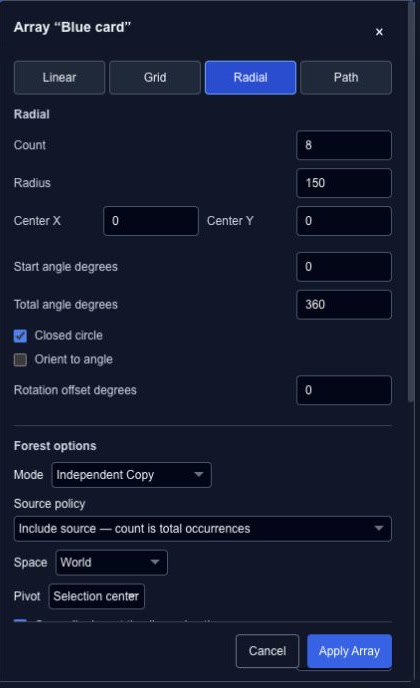

# Arrange copies in a line, grid, circle or path

An array repeats a selection with a consistent placement rule. Select the source layers, then open **Clone / Array → Array**. The preview lets you inspect the arrangement before applying it.

| Pattern | Main controls |
| --- | --- |
| Linear | Count, move, rotation and scale steps. |
| Grid | Rows, columns, row/column offsets and alternating-row stagger. |
| Radial | Center, radius, start/total angles and orientation. |
| Path | Target path, start/end offsets, normal offset and tangent alignment. |

## Make a radial arrangement

Choose Radial, start with six copies and set a radius that keeps them apart. Use Closed circle for an even ring. Turn on Orient to angle if each copy should face around the ring rather than retain the same rotation.

## Review the shared options

Choose Copy or Instance, a coordinate space and a pivot. The source policy determines whether the count includes the original selection. With animation copying enabled, **Time offset per occurrence** staggers each repetition.

Apply once the preview is right; Undo returns to the source selection. Changing the source while the dialog is open can invalidate the preview, so reopen it after unrelated edits. The multi-root **Procedural Repeater** conversion is currently unavailable in this tool.
