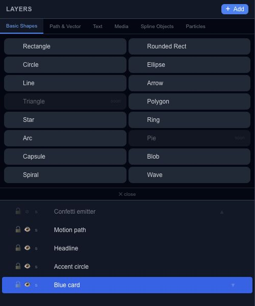

# Draw and edit basic shapes

Basic shapes are a useful starting point for cards, badges, diagrams and motion graphics. Open **Layers → Add → Basic Shapes**, choose a shape, and place it on the canvas.

## Choose a shape

Rectangle, Rounded Rect, Circle and Ellipse cover the common filled shapes. Line and Arrow work well for connectors. Polygon, Star, Ring, Arc and Capsule provide more specific outlines. Blob, Spiral and Wave expose geometry controls for more organic or repeated forms.

**Triangle** and **Pie** are marked **soon** in this palette. Their presence in the menu does not mean those creation buttons are available.

## Change its geometry

Select the shape and open Properties. The controls depend on the selection: a star exposes point count and radii, an arc exposes angles, and a wave exposes amplitude, frequency and phase. Blob's seed lets you return to a repeatable irregular outline.

For a simple shape animation, start with a rectangle and animate its X position or opacity in [Keyframes](editor-keyframes.md). Keep geometry changes separate at first so you can see which change affects the result.
