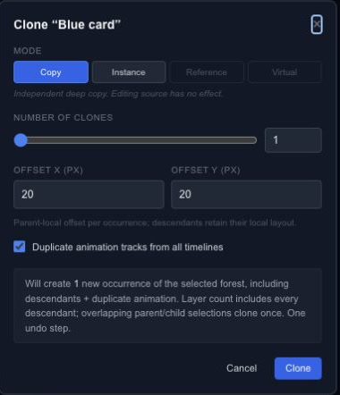

# Duplicate layers with Copy or Instance

Use Duplicate for a quick copy. Open **Clone / Array → Clone with settings** when you need several copies, a deliberate offset or control over how appearance is shared.

## Choose what stays linked

**Copy** creates an independent copy. **Instance** links appearance while keeping transforms and copied animation independent. For groups, child membership is captured at cloning time; adding a child to the source group later is not a promise that it appears in every instance.

Set the count and X/Y offsets, then decide whether to copy the relevant timeline animations. Check a copied layer's tracks before assuming it starts at the same time as the source.

## Try a small change

Make one instance of a colored card. Move the instance, then change the source appearance and compare both objects. Undo the change to see which part of the relationship is shared. Use Copy when later appearance changes must remain independent.

**Reference** and **Virtual** are disabled in the dialog. For repeated placement along a line, grid, circle or path, continue with [Arrays](editor-layers-arrays.md).
