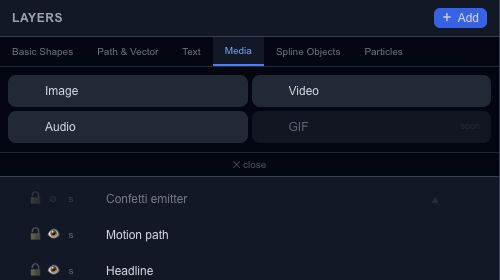

# Add image, video and audio layers

Use a media layer when the source is an existing image, video or sound. The asset is the imported file; the layer is where and when that asset appears in the scene.

## Place and fit an image

Choose **Image**, pick a file and adjust the layer's dimensions. **Object Fit** controls how the image occupies those bounds. Compare Contain and Cover when cropping matters rather than stretching the picture to force it into place.

## Check video and sound

Video exposes volume, mute, loop and source-start controls. Audio also has gain, source-in, fade and pan controls in its supported inspector. Source time and scene time are different: moving a clip later does not mean you want to skip the beginning of its file.

Play across the clip boundary and listen after every trim. Keep the master level in mind when normalizing or increasing gain; several individually reasonable tracks can still become too loud together.

The **GIF** Add button is marked soon. GIF files can instead enter through the [file import workflow](editor-assets-import.md), which creates a frame-sequence asset/layer. See [Assets](editor-assets.md) to manage reused files.
