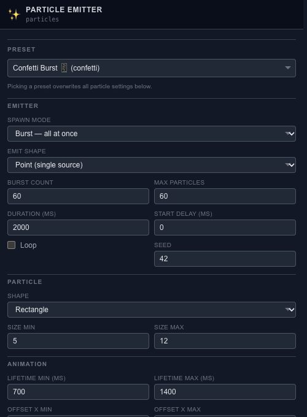

# Create and tune a particle emitter

A particle emitter creates many small moving elements from one layer. Add it through **Layers → Add → Particles**, then use the **Particle** panel for its settings. Position and overall opacity remain in Properties.

## Set where particles begin

Choose **Burst** for a single release or **Continuous** for ongoing emission. Point, Circle, Rectangle and Line control the birth area. **Scene Layer** uses another eligible layer's geometry bounds as the source; moving that source changes where particles appear.

Set the burst count or rate, maximum particles, duration, delay and loop. Start with a modest count so individual changes are easy to see.

## Give them a useful lifetime

Choose a particle shape and size range. Lifetime, X/Y movement ranges and rotation velocity determine how the burst develops. Randomness controls vary position, size, rotation, delay, lifetime and color. Keep the seed fixed while comparing other settings.

## Finish the look

Try a preset for confetti, weather, smoke or a trail, then adjust it. Choosing a preset replaces the current particle settings. Check blend mode against the actual background and use soft edges or higher quality only when they improve the result. Inspect [Resources](editor-resources.md) when increasing the count.
