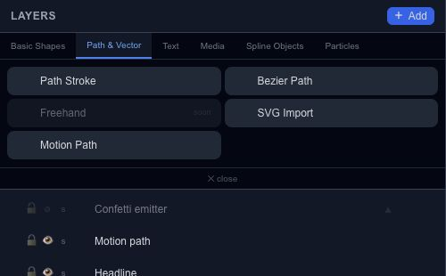

# Create vector paths and animated strokes

The Path & Vector tab contains several tools with different jobs. Choose according to whether the path is visible artwork or a route another object should follow.

| Choice | Best used for |
| --- | --- |
| Path Stroke | A stroked path with trim and optional glow controls. |
| Bézier Path | An editable outline made from points and curve handles. |
| SVG Import | Bringing existing vector artwork into the scene. |
| Motion Path | Defining a movement guide for another layer. |

**Freehand** is currently marked **soon** in this palette.

## Reveal a stroke

Create a Path Stroke, choose its path shape or supply a custom SVG path, and set the stroke width and color. Use its trim controls to reveal a portion of the stroke, then animate the trim offset to move that portion along the path.

For a logo or icon, inspect the fill, stroke and bounds after [SVG import](editor-assets-import.md). For a moving object, use [Follow Path](editor-properties-motion.md) instead of assuming a visible stroke automatically controls movement.
