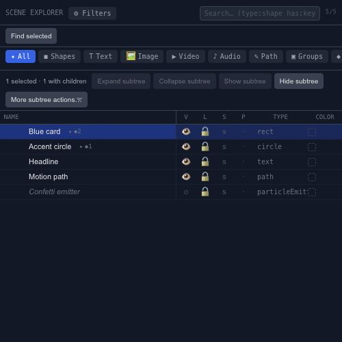

# Find and organize layers in Scene Explorer

Scene Explorer is useful once a project is too busy to navigate by clicking the canvas. Its rows describe the source hierarchy, while columns expose common layer states.

## Find a layer

Search by name, use a type filter, or try a query such as `type:shape has:keyframes`. **Find selected** brings the current selection into view when it is outside the visible rows. Clear a restrictive filter before concluding that a layer has disappeared.

## Work with a branch

Expand or collapse a group to navigate its children. Subtree operations apply to the selected layer and its source descendants, including children outside the current filtered view. Read the selection count before locking, hiding or freezing a branch.

Visibility, Lock, Solo and Pin are separate states. Use isolation for a temporary focused view and Show All to restore visibility. Color labels help distinguish related objects without changing their names.

Right-click a row for duplication, deletion, grouping and other available actions. After moving a layer in the hierarchy, check its placement: a parent transform affects its children. Keep [Clone and Instance](editor-layers-cloning.md) separate from ordinary group organization.
