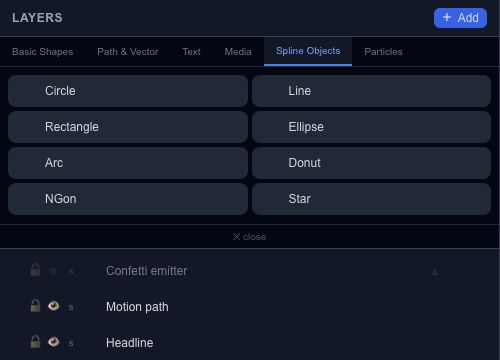

# Start a spline from a familiar shape

Spline Objects start with a recognizable shape and keep an editable point-based representation. They are handy when a circle, rectangle or star is close to the outline you need but not quite right.

## Available starting shapes

The tab offers **Circle, Line, Rectangle, Ellipse, Arc, Donut, NGon and Star**. Choose a primitive, place it, then inspect its points and handles. A donut contains more contour structure than a line, so take care to select the intended contour before editing.

## Refine the outline

Move one point a little, then adjust its handles. Use the point inspector for an exact coordinate or point type. Keep the object selected while switching between Properties and the canvas so you can compare the outline with its fill and stroke.

For a custom badge, start with a rectangle and soften or reshape a few corners. This is usually easier to revise than drawing a complex outline in one pass.

Continue with [Bézier points and splines](editor-canvas-splines.md) for point types, contour closure and appending. A spline's editable shape is separate from the [motion path](editor-properties-motion.md) that can move another object.
