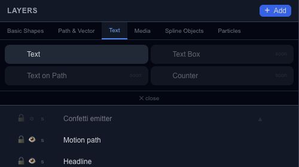
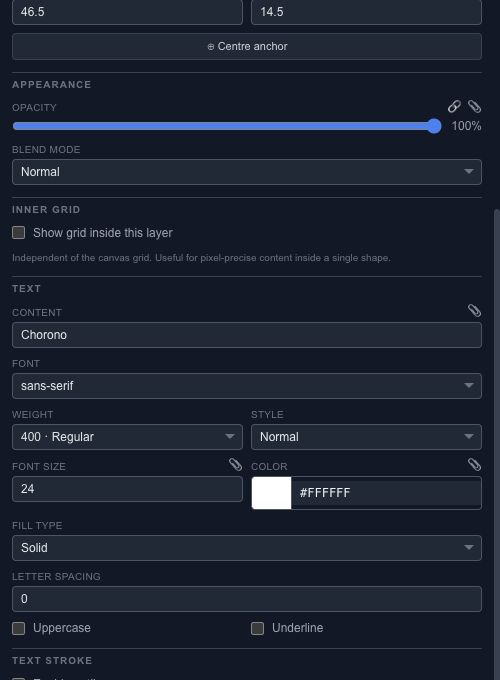

# Create and style an animated text layer

Add a text layer from **Layers → Add → Text**, then select it and edit its content in Properties. Start with a short line that stays readable at the size you plan to export.

## Shape the typography

Choose a font family, weight, style and size. Adjust letter spacing before trying to compensate with layer scaling. Use the uppercase and underline controls when the design calls for them.

Text supports a solid fill or gradient, a stroke and a shadow. Check a small preview after adding an outline: a heavy stroke can close the spaces inside small letters. Imported font files belong in the asset workflow; confirm that the required font is available when you reopen the project.

## Animate the layer

Set an initial opacity key, move the playhead and add a second value. Then add a small position change if the entrance needs movement. This gives you a text animation you can adjust without changing the wording.

**Text Box**, **Text on Path** and **Counter** are marked **soon**. Converting supported text to a spline gives you editable outlines; preserve a text copy if you expect wording changes later.
