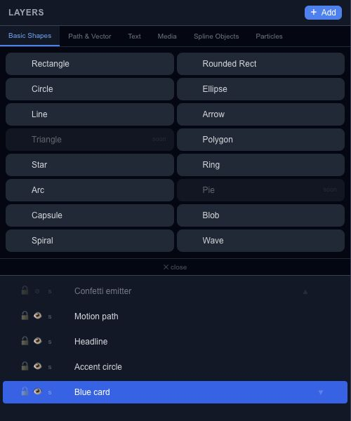

# Layers and scene hierarchy

A layer is an editable object in your Chorono scene. Use the Layers panel and Scene Explorer to find objects, inspect their hierarchy and select the right target before changing its properties.

## Select and name objects

Select a layer in the panel to inspect it on the canvas. Give it a descriptive name such as “Title”, “Background” or “Progress fill”. Names help people and agents understand a project; internal IDs keep references to objects stable.

Use the hierarchy when a small object is difficult to click or another layer covers it. Check that the Properties panel identifies the intended selection before editing.

## Groups and drawing order

Group related objects when they should be organized or transformed together. A parent transform affects its children, so a child's position belongs to its parent coordinate space. Ungroup only after checking the resulting placement and animation.

Layer order affects how overlapping objects are drawn. Inspect the canvas after changing order, especially when the scene contains masks, blending or transparent content.

## Visibility, locking and copies

Visibility helps isolate an object while you work. Locking protects a layer from accidental editing. Review the final scene after changing either setting; an editor-only convenience is not a guarantee of equivalent behavior in every [export format](export-overview.md).

When duplicating an animated object, inspect the copy's tracks and targets in the [timeline](editor-timeline.md). A new name alone does not tell you whether an animation was copied. Play the result before deleting or replacing its source.

## Continue editing

Use [Properties & effects](editor-properties.md) to edit the selected object, [Keyframes](editor-keyframes.md) to animate it and [Project JSON](export-project-json.md) to keep an editable copy of the hierarchy.

## Keep the animation hierarchy visible

Layers, Scene Explorer and Timeline share the same parent/child hierarchy. Search filters, collapsed branches and rows outside the visible area do not remove layers from the project.

Use **▤ Timeline** in Layers to reveal the selected layers in the timeline, or **Find selected** inside Timeline. Their parent paths and animation rows open as needed. **Restore filters** brings back the earlier filtered view after a reveal. Selection alone does not keep pulling the scroll position away from your work.

For operations on a whole branch and temporary isolation, use the [Scene Explorer guide](editor-layers-scene-explorer.md#work-with-a-branch). For independent copies or instances, see [Clone and Instance](editor-layers-cloning.md).
