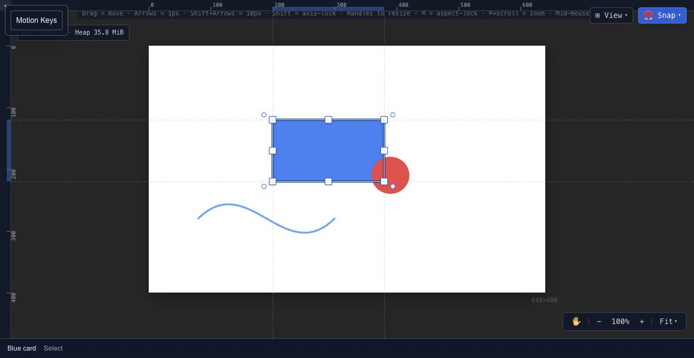
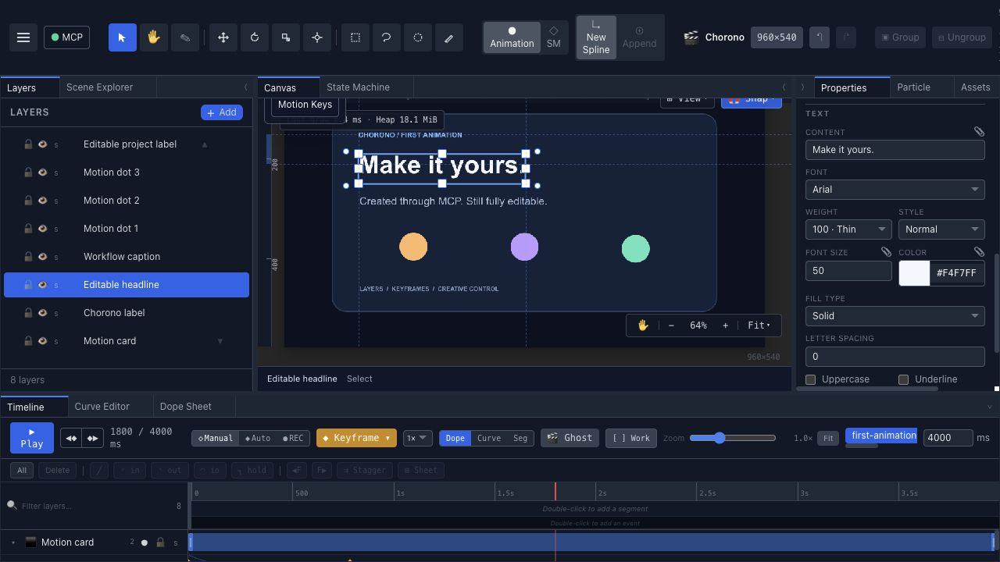

# Chorono editor workspace

The Chorono editor keeps your scene, animation and interactions in one editable project. Start with the canvas in the center, the scene hierarchy on the left and the selected layer's properties on the right.

## Find your way around

| Area | What it is for | Guide |
| --- | --- | --- |
| Top toolbar | Select and draw, switch modes, preview, save and export | [Canvas & tools](editor-canvas.md) |
| Canvas | Place objects and inspect the composition | [Canvas & tools](editor-canvas.md) |
| Scene Explorer / Layers | Select, name and organize objects | [Layers & hierarchy](editor-layers.md) |
| Properties | Change the selected layer's appearance and behavior | [Properties & effects](editor-properties.md) |
| Timeline, Curve Editor, Dope Sheet | Edit time, property tracks and easing | [Timeline & playback](editor-timeline.md) |
| State Machine | Connect animation states and transitions | [State machines](editor-state-machines.md) |
| Resources & Performance | Inspect tracked resources and rendering work | [Resources & performance](editor-resources.md) |

## Make a small edit

1. Open the project in [Your first animation](getting-started.md).
2. Select a named layer in the Layers panel.
3. Change one static property, such as its fill color.
4. Scrub the timeline to inspect the animated result.
5. Save an [editable project](export-project-json.md) and reopen it.

For motion, continue with [keyframes](editor-keyframes.md) and [looping animations](loop-animation.md). Select the intended timeline before editing a scene that contains multiple animations.

## Preview, save and export

Preview checks the current scene's playback. Saving preserves the source you can edit later. Export creates a delivery format for another context. Choose the [Export guide](export-overview.md) for images, HTML or runtime JSON, then use [Runtime](runtime-overview.md) when embedding playback in an application.

## Work with an agent

You can edit manually or [connect an AI agent through MCP](connect-ai-agent.md). The agent works with the same native scene. [JavaScript scripting](scripting.md) provides procedural authoring; it is separate from the playback SDK used by a website.
