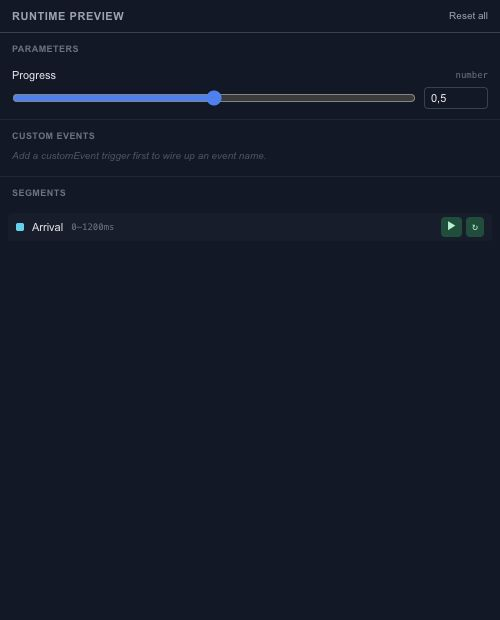

# Preview animation and interactive behavior

Preview answers a different question from editing: does the scene behave correctly when it is played and used? Check ordinary playback first, then test the interactions you have added.

## Timeline playback

Use Play and the time ruler to inspect the animation at normal speed and at specific moments. Check the start, the fastest movement, the end and any loop boundary. Select the intended timeline when the project contains several independent animations.

## Runtime preview

The runtime preview exposes active timelines, parameters and state-machine behavior. Change a test input and inspect the response. Try repeated clicks or drags, not only the first successful interaction.

Reset the runtime test when you need to compare the scene's initial state. Runtime input changes are not the same as rewriting the source defaults in Properties or Parameters.

## Player and export

Use the player preview for the playback path that will consume the runtime scene. Then [export runtime JSON](export-runtime-json.md) and test that file with the intended SDK. An editable project and a runtime payload have different purposes; keep the source project so the animation remains easy to revise.
