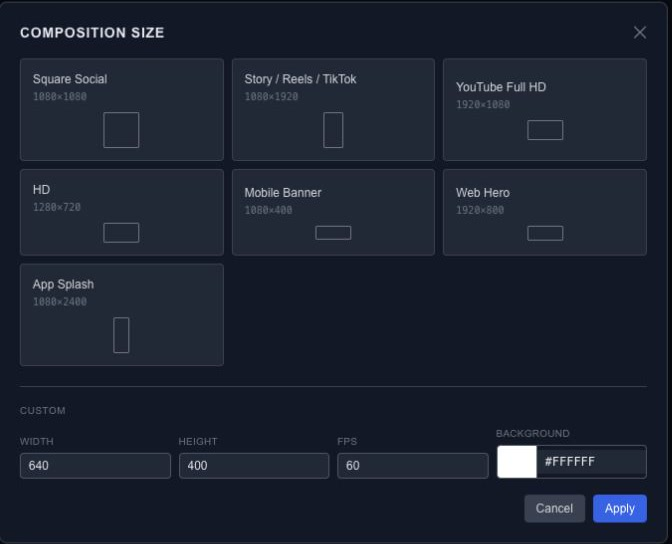

# Set up and save an animation project

A project starts with a composition: the area you draw in and the time your animation occupies. Set those before arranging a finished layout so you have a useful frame of reference.

## Choose a composition

Click the size button in the top toolbar. Choose a preset or enter a width and height in pixels, then set the frame rate. Set the duration in the composition controls in Properties. A wider composition gives you more room; zooming the canvas only changes your view of it.

With no layer selected, Properties also exposes the composition's dimensions, duration and background. Use a solid color or a gradient to establish the background before checking text contrast.

## Keep an editable copy

Open **Project → Save Scene JSON** to download the scene. **Choose Save Folder** enables folder saving in a browser that supports it; **Save Version** creates a timestamped snapshot. If folder access is unavailable, the JSON download remains the way to keep a copy.

Use **Inspect Scene JSON** when you need to examine the source, or **Copy Scene JSON** to copy it. For reopening and portable media, continue with [Project JSON](export-project-json.md).

## Arrange the workspace

Drag a dock tab to move a panel, or drag a divider to resize it. A closed panel can be restored from the File menu. **Reset Panel Layout** restores the workspace arrangement; it does not replace your animation.
