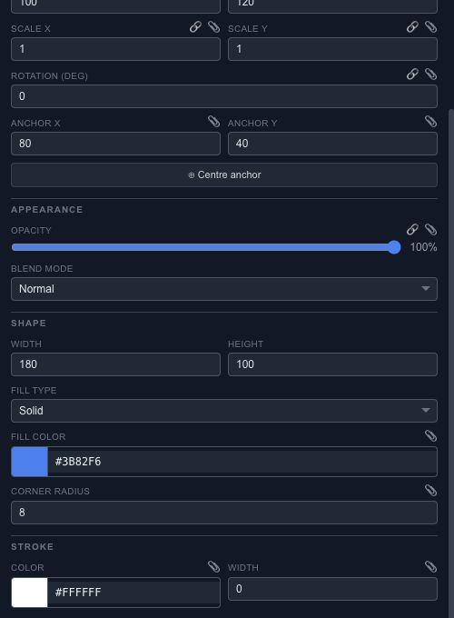

# Style a layer with fills, strokes and opacity

Start with a shape that has a clear silhouette. A fill sets its interior, a stroke gives it an outline, and opacity controls how strongly the whole layer appears over what is behind it.

## Build the appearance

Choose the fill color or an available gradient mode, then adjust the gradient stops and direction. Add a stroke if the edge needs definition. Check a thin outline at the final export size; a zoomed-in canvas can make it look more substantial than it will be in the result.

Use opacity for a fade. Use a blend mode when the layer should combine differently with the colors underneath it. A blend mode needs overlapping content to produce a meaningful comparison.

## Shape-specific settings

Properties changes with the selection. A rectangle exposes its dimensions; a rounded rectangle adds corner controls. Stars, rings, arcs and other shapes expose the settings that define their geometry. Text has typography controls instead of pretending to be another rectangle.

If a change should happen over time, add a track for a supported property and compare two keyframes. For blur, shadows and other effects around the shape, continue with [Effects](editor-properties-effects.md).
