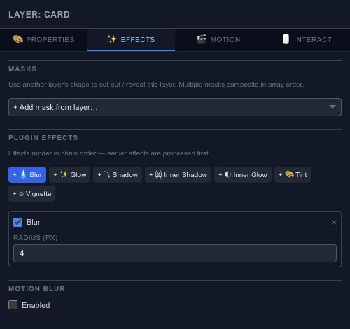

# Add blur, glow, shadows and color effects

Open **Effects** after selecting a layer. Add one effect at a time so you can tell what each change contributes. A subtle shadow can separate a card from its background; a glow can give a bright object a softer edge.

## Available effects

The tab offers **Blur**, **Glow**, **Shadow**, **Inner Shadow**, **Inner Glow**, **Tint** and **Vignette**. Each added effect exposes its own controls. Use its checkbox to compare the result with the effect bypassed, or remove it with the close button.

Effects run in chain order. Blurring a tinted shape and tinting an already blurred result can produce different edges. Review the composition after combining several effects instead of relying on the panel alone.

## Motion blur

Enable Motion Blur for a moving layer and compare frames where it is travelling fastest. Keep a sharp version for reference. Trail Count, Frame Interval, Max Opacity and Speed Threshold control the visible trail. Higher sampling or a longer blur can change both the look and rendering work, so inspect [Resources](editor-resources.md) if playback becomes less responsive.

**Bake Motion Blur** is marked as coming soon. Keep the editable settings as your working source.

Export support varies by output format. A still image and a vector export do not preserve every effect in the same way; check warnings in the export dialog and inspect the resulting file.
