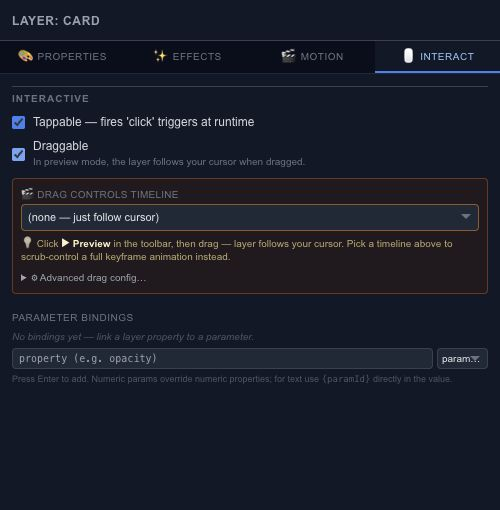

# Make a layer respond to interaction

An animation can respond to the viewer as well as to a clock. Open **Interact** for the layer that will receive input, and decide which action should feel natural for that object.

## Tapping and dragging

Enable tappable behavior for a button-like object. For dragging, choose the allowed axis and bounds so the object stays in a useful area. A horizontal slider should not drift vertically while the viewer is adjusting it.

Map drag progress to a timeline or parameter when the gesture should control an animation. Keep the input range and output range deliberate: reaching the end of the drag should produce the intended end state.

## Following the cursor

With no drag-controlled timeline selected, a draggable layer follows the pointer during the drag. Test it near the edges of the composition as well as in the center. Choose a timeline in the drag controls when the gesture should scrub an animation instead.

## Test the full response

Use [Preview](editor-preview.md) to try the interaction. The editing canvas has its own selection and drawing gestures, so it is not a substitute for runtime input testing. Use [Events](editor-state-machines-events.md) when a click or drag should trigger several explicit actions.
