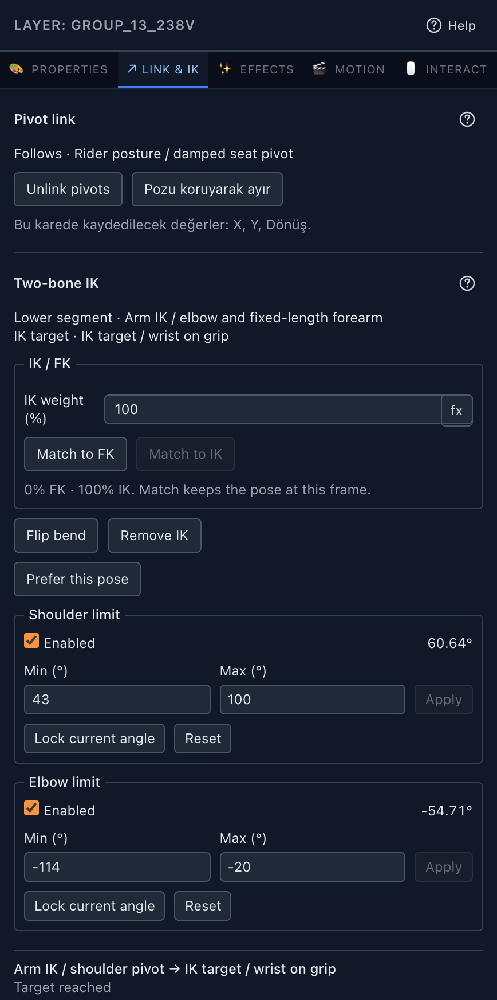

# Link layers and set up two-bone IK

Use **Properties → Link & IK** to attach a prop at a pivot or pose a two-part limb by moving a target. Use an editor build that shows the **Link & IK** tab.

## Link layer pivots

1. Put the two layers in the same group or at the scene root.
2. Select the layer that should follow the other. Open **Properties → Link & IK** and choose **Pick driver in viewport**.
3. Click the driver on the canvas. The follower keeps its pose at the moment of linking. Move or rotate the driver to check that the follower moves with it. The follower keeps its own scale.

The dashed arrow points from the follower toward its driver. Press **Esc** or right-click to cancel while picking.

Use **Unlink pivots** to return the follower to its authored transform. Use **Pozu koruyarak ayır** (unlink and keep pose) to keep its visible position and rotation at the current frame. The panel lists which channels will change. Existing keyed channels receive a key at that frame. Static channels update their source values. Unlinking a lower segment also removes its IK constraint. Undo restores both the link and the constraint in one step.

## Set up two-bone IK

1. Put an upper arm, a forearm and a wrist target in the same group or at the scene root. Place the upper arm's [anchor](editor-properties-transform.md#rotation-and-anchor) at the shoulder, the forearm's at the elbow and the target's at the wrist. Use a small shape or an empty group for the target.
2. Select the forearm and link its pivot to the upper arm as described above.
3. Select the upper arm and choose **Set up IK in viewport**. Pick the forearm first, then the wrist target. For an empty group, click its pivot marker.
4. Move the target to bend the arm. Use **Flip bend** to switch the elbow side. Use **Remove IK** to take out the constraint and keep the pivot link.

The shoulder, elbow and wrist must start at distinct joints. Keep the target separate from the two driven segments and avoid circular links. This setup uses two rigid segments and also works for a thigh and shin or a mechanical arm.

## Animate the target

Move the playhead to the desired frame, turn on **Auto** keying and drag the target by the center of its crosshair. Releasing the drag keys the changed X and Y channels. Move to another frame and repeat, then scrub through the [timeline](editor-timeline.md) to check the motion. Pressing **Esc** during the drag restores the original pose.

The turquoise crosshair marks the requested target. The copper ring marks the actual tip. If they separate, check **IK reach** in the panel for the remaining distance in composition pixels and the reason, such as a joint limit or full extension. The guides stay on the editor canvas.

## Set joint limits

Select the upper segment. Enable **Shoulder limit** or **Elbow limit**, enter **Min** and **Max** in degrees and choose **Apply**. The shoulder angle is relative to its driver's X axis or, with no driver, the common parent's X axis. The elbow angle is relative to the upper segment.

**Lock current angle** holds the joint at the evaluated angle. **Unlock angle** restores the configured range, while **Reset** clears that joint's limit. For an equal-length chain that folds onto its shoulder, **Prefer this pose** records the shoulder direction to use at full fold.

## Switch between IK and FK

Select the upper segment and adjust **IK weight (%)**. At 100% the target controls the limb through inverse kinematics (IK). At 0% the authored joint transforms control it through forward kinematics (FK).

- **Match to FK** writes the visible pose to the two joints and sets the weight to 0%.
- **Match to IK** moves the target to the visible tip, matches the bend side and sets the weight to 100%.

Use Match at the transition frame to keep the pose while changing how the limb is controlled. With **Auto** on, the change can create keys. In manual mode it updates existing keyed channels at that frame and writes unkeyed channels to their source values. If a joint limit or another driver prevents a match, the panel reports the problem and leaves the pose intact.

Open the editable [Night Dispatch project](https://www.chorono.com/animations/style-animations/night-dispatch) to inspect an elbow and knee chain. Scrub over a bump and check how the linked wrist and ankle targets follow the handlebar and footrest.
