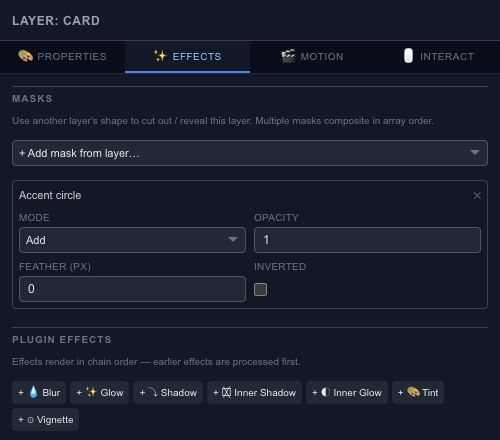

# Reveal a layer through another shape

A mask uses another layer's shape to control which part of the selected layer is visible. For example, a circle can reveal a moving image through a round window.

## Add a mask

Select the content you want to reveal, open **Effects**, then choose a source in **Add mask from layer**. Adjust the source shape on the canvas to change the revealed area. Keep the content layer and the mask source clearly named so they are easy to distinguish later.

## Combine and soften

**Add**, **Subtract** and **Intersect** determine how masks combine. Multiple masks are evaluated in their listed order. **Inverted** reverses the mask, **Opacity** reduces its strength, and **Feather** softens its edge in pixels.

Begin with one unfeathered mask. Once the boundary is correct, soften it slightly and preview against the final background. A large feather can hide the edge you were trying to align.

## Check animated masks

Scrub through the full animation when either the source or the content moves. A good first frame does not guarantee that the mask covers the intended area later. Remove a mask from this panel to detach the relationship without deleting its source layer.
