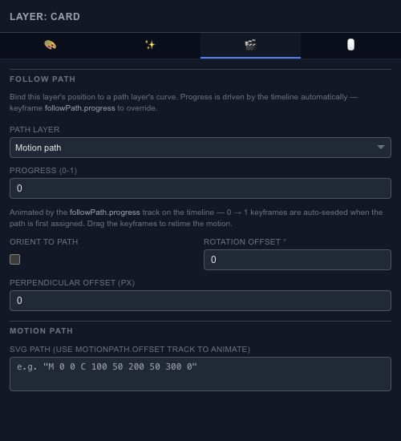

# Move a layer along a path

Use **Motion** when an object should travel along a route instead of moving independently on X and Y. Draw or choose the path first, then select the object that should follow it.

## Follow a path

Enable Follow Path and choose the path layer, or use the supported SVG path input. Progress chooses a position along the route. Animate progress to make the object travel rather than editing every intermediate position by hand.

Enable orientation along the path when the object should turn with the route. Leave it off for a label or icon that should stay upright. Use rotation and position offsets to correct the relationship between the object's artwork and the path.

## Compare the complete motion

Scrub the whole route after changing the path. A curve that looks smooth at one point can still turn abruptly elsewhere. The trail controls and the coming-soon Bake action belong to **Effects → Motion Blur**; see [Effects](editor-properties-effects.md) for that workflow.

For keyframes drawn directly on a motion trajectory, see [Motion Keys](editor-canvas-motion-keys.md).
