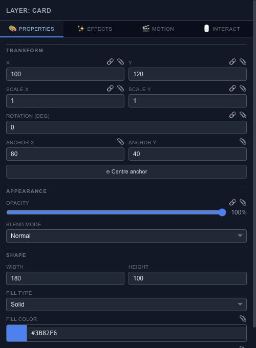

# Position, rotate and scale a layer

Select a layer to edit its transform. Moving a shape on the canvas is useful for rough placement; the Properties fields help when two objects need to line up exactly.

## Position and scale

X and Y place the layer in its parent coordinate space. Scale X and Scale Y change its size relative to the source geometry. They do not replace a rectangle's width and height or a text layer's font size.

Set a position, scrub the timeline and watch the result. If an animated track controls that property, playback may produce a different value from the layer's base value. Edit the relevant keyframe when the change belongs to the motion.

## Rotation and anchor

Rotation is measured in degrees. The anchor is the point around which rotation and scaling act. **Centre anchor** is useful for a spinning card; an edge anchor suits a swinging sign. Changing the anchor can change how an existing animation looks, so check the whole movement afterward.

## Connect or animate a value

The small connection controls beside supported fields open parameter wiring. Use them when a value should follow another value through a relationship. For a value that changes at specific times, use the [Keyframe Inspector](editor-keyframes-inspector.md).
