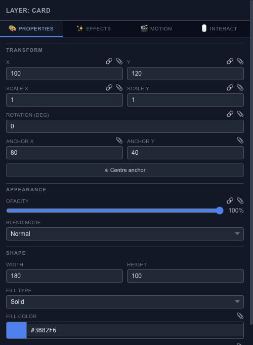
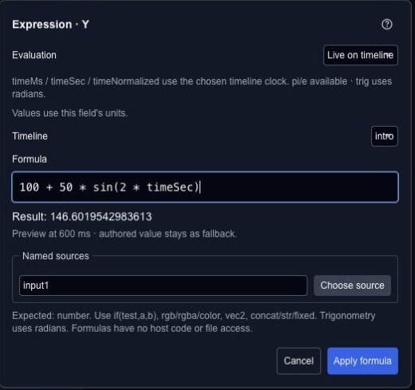

# Edit layer properties and effects

The Properties panel shows the controls supported by the selected Chorono layer. Select an object first; available geometry, text, media and effect controls depend on its type.

## Transform and appearance

The transform controls include position, scale, rotation and anchor. Position and anchors use scene or parent coordinates, rotation is in degrees, and scale is a multiplier: 1 is the original scale. An anchor changes the pivot used for scaling and rotation.

Appearance controls include opacity and blend mode. Inspect overlapping content when changing blending. The panel may show opacity as a percentage while serialized data uses a normalized value.

## Type-specific controls

Shape controls describe geometry and paint. Text controls describe content and typography. Media layers refer to assets. Select a different layer type to see the controls relevant to that object; avoid assuming that all layers expose the same properties.

## Effects, motion and interaction

The **Effects**, **Motion** and **Interact** areas organize additional behavior. Make one change at a time and preview the result. Effects can increase the rendering work and may have different support in SVG, HTML and runtime output.

Use [Resources & performance](editor-resources.md) to inspect the scene's workload and [State machines](editor-state-machines.md) for animation states and transitions.

## Animate a property

1. Select the correct layer and timeline.
2. Move the playhead to the desired time.
3. Add or update a keyframe for a supported property.
4. Move to another time and set the next value.
5. Scrub between the keys to check the interpolation.

Review the active keyframe mode before editing a value. Read the [Keyframes guide](editor-keyframes.md) for the full workflow. Keep a saved project before major changes and inspect the actual exported result rather than relying only on the editor preview.

## Animation expressions and formulas

Use a formula when a property should follow a calculation rather than a value you type by hand. Click **fx** beside a supported field; numeric fields also open the formula editor on double-click. Color, checkbox and select controls use their own fx button.

Choose **When applied** to calculate once and save both the recipe and its result. Choose **Live on timeline** to reevaluate the recipe using the selected timeline's clock. A saved one-time formula does not run on every frame.

For a simple sine wave animation, apply `100 + 50 * sin(2 * timeSec)` to a supported numeric property. It moves around 100 with an amplitude of 50. `timeMs` is milliseconds, `timeSec` is seconds and `timeNormalized` is normalized timeline progress. Trigonometric functions use radians; the Rotation field still expects degrees.

| Result | Example | Where it fits |
| --- | --- | --- |
| Number | `1920 / 2` | A numeric field; the result is 960 |
| Boolean | `timeMs >= 500` | A supported true/false property |
| Color | `rgba(40 + 20 * timeSec, 100, 200, 0.8)` | A supported color field, for example over 0–3 seconds |
| Point | `vec2(40 + 20 * timeSec, 80)` | A supported point or handle in layer-local coordinates |
| Text | `concat("Time: ", fixed(timeSec, 1))` | A supported text property |

The result must match the field. A select property accepts only its listed options; a number does not stand in for a boolean. Check the field's units too: layer opacity uses 0–1 in source expressions, while fill opacity uses 0–100.

Named sources let a recipe refer to supported scene values. References use stable layer IDs and property paths, so a label alone is not the connection. Missing references, circular dependencies and conflicts with keyframes, controllers or Wires are shown for review. Applying a formula does not silently replace another owner of that property.

### Keep a value or return to the authored value

**Convert to value** removes the live driver and keeps the reviewed result. **Keep authored value** removes the driver and restores the property's authored fallback. To preserve the motion over time instead, [bake the expression to keyframes](editor-timeline-controllers.md#bake-a-live-expression-to-keyframes).

If another edit changes the source while the dialog is open, choose **Review current source** before applying. Formula text uses a restricted expression language; it is not general JavaScript and cannot access files or the network.

## Calculate once for operation settings

Array counts, guide positions, keyframe times and export settings can offer **Calculate once**. For example, enter `1920 / 2` for a guide position and use the result, 960. Only the resulting number is passed to the operation. This does not save a property formula or create a live animation driver.
