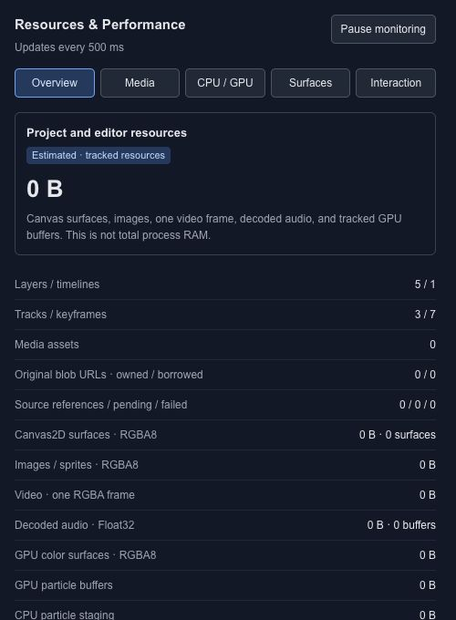
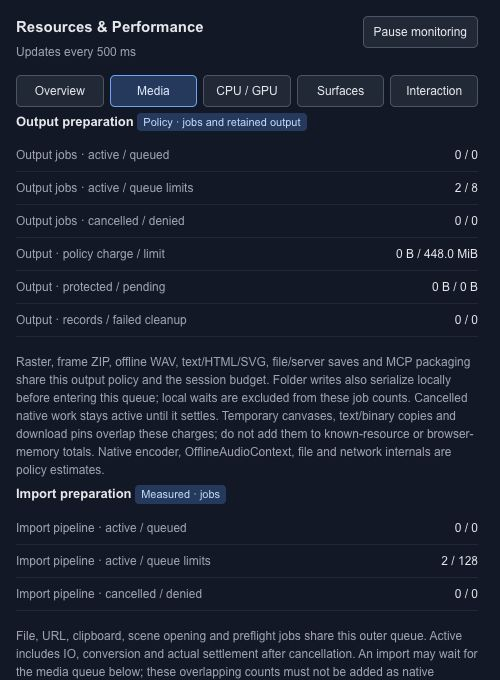
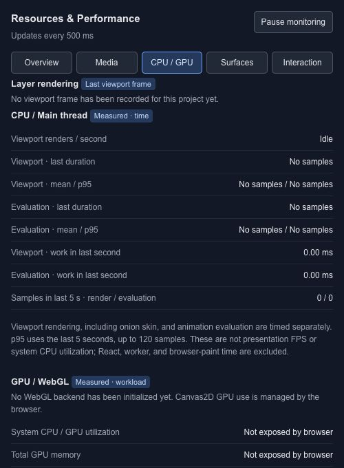
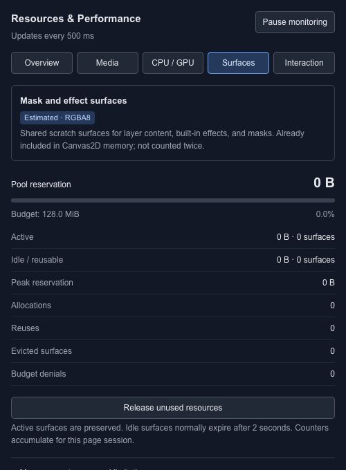
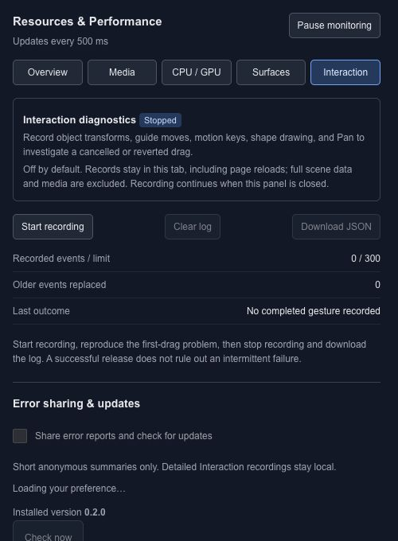

# Resources and performance

Open **Resources** to inspect the Resources & Performance panel. It separates tracked project resources, media and rendering measurements so you can understand a scene's workload while editing.

## Read the overview

The overview includes counts such as layers, timelines, tracks, keyframes and media assets. The memory figure is an estimate of tracked resources, including surfaces, decoded media and GPU buffers where tracked. It is **not total process RAM** and does not measure every browser allocation.

Use **Pause monitoring** when you want to hold a reading. Comparing numbers from different playback positions or different loaded media is not a controlled performance comparison.

## Choose a detail view

| View | What to inspect |
| --- | --- |
| Overview | Project counts and tracked resource totals |
| Media | Loaded media and asset-related resources |
| CPU / GPU | Work attributed to rendering and processing |
| Surfaces | Canvas and rendering surface allocations |
| Interaction | Work associated with editor interaction |

## Investigate a slow scene

1. Save a copy of the project.
2. Return to the same playhead time before comparing changes.
3. Inspect large media, dense particle layers and expensive effects.
4. Change one factor and replay the same interval.
5. Check the intended [export](export-overview.md) or [runtime](runtime-overview.md) separately.

A responsive editor does not establish how every target device will perform. The runtime package has its own version and capabilities. Use the panel to find concrete work to investigate, and keep visual quality checks alongside resource measurements.

## Media resources

Media covers imported assets, decoded resources and output preparation. Look for pending or failed work before treating a missing picture as a rendering problem. A large original file, its decoded pixels and a prepared export are different allocations.

## CPU and GPU work

CPU / GPU shows recorded work such as viewport rendering and evaluation. No samples means there is no measurement to interpret yet. Compare the same scene and playback interval before and after a change; these readings are not a system-wide GPU benchmark.

## Rendering surfaces

Surfaces shows the memory reserved for temporary rendering work, including masks and effects. Active, reusable and peak allocations answer different questions. Pool figures that are already part of a total should not be added to that total again.

## Interaction diagnostics

Interaction can record object transforms, guide movement, motion-key edits, shape drawing and panning. Start recording before reproducing a cancelled or reverted drag, then inspect or download the log. Recording is off by default; the panel explains what is retained and provides a clear-log action.

