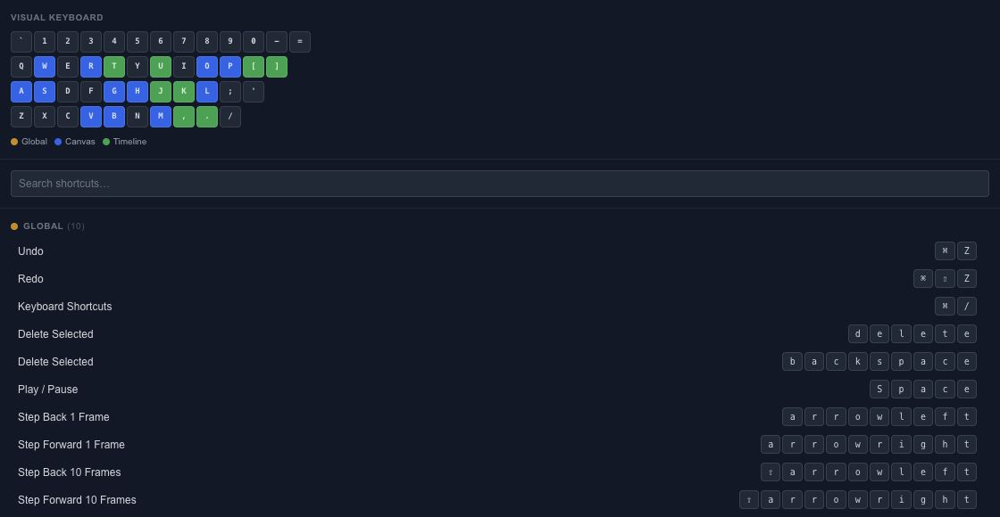

# Find keyboard shortcuts for the editor

Open the keyboard-shortcut reference when you want to speed up a repeated task. Search for the action you need instead of memorizing every command at once.

## Start with frequent actions

Learn selection, playback, Undo/Redo and the tools you use most. Add timeline and spline-editing shortcuts as those workflows become familiar. The reference displays the registered commands and their context.

A shortcut can behave differently while a text field is focused. Finish or cancel the text edit before trying a canvas or timeline command. Platform-specific modifier labels should be read from the running editor.

## Keep the editing context clear

Select the intended layer, keyframes or spline points before using a command that acts on a selection. When a shortcut appears to do nothing, check the active tool and focus before repeating it.

Use Undo after a command whose result you did not intend. The [Canvas tools](editor-canvas-tools.md), [Keyframes](editor-keyframes.md) and [Spline editing](editor-canvas-splines.md) guides explain the underlying operations so the shortcut is a convenience rather than a hidden requirement.

## Canvas and timeline shortcuts

Cmd/Ctrl means Command on macOS and Control on other supported platforms. Finish typing in an input before using a workspace shortcut.

| Context | Shortcut | Action |
| --- | --- | --- |
| Editor | Cmd/Ctrl+Z / Cmd/Ctrl+Shift+Z | Undo / Redo |
| Editor | Space | Play or pause |
| Canvas | V, M or H, P | Select, Pan, Pen |
| Canvas | G, R, S, A | Move, Rotate, Scale, Anchor |
| Canvas | B, L, O, W | Box, Lasso, Circle, Paint selection |
| Canvas | Arrow / Shift+Arrow | Move by 1 / 10 pixels |
| Canvas | Cmd/Ctrl+scroll | Zoom the canvas |
| Timeline | Left/Right / Shift+Left/Right | Step 1 / 10 frames |
| Canvas or Timeline | K | Set Key using the current keying set |
| Timeline | Comma / Period | Previous / next key |
| Timeline | Home / End | Timeline start / end |
| Timeline | Shift+Home / Shift+End | First / last key |
| Timeline | P, S, R, T | Show position, scale, rotation, opacity tracks |
| Timeline | U | Show animated properties |
| Canvas | Cmd/Ctrl+D | Duplicate |
| Canvas | Cmd/Ctrl+G / Cmd/Ctrl+Shift+G | Group / ungroup |
| Canvas | Cmd/Ctrl+Shift+A | Open Array |

For a drag-copy, hold Alt or Cmd/Ctrl before the pointer goes down; use Cmd/Ctrl+Shift for an instance drag. Release the pointer to complete the operation. See [Clone and Instance](editor-layers-cloning.md#duplicate-a-branch-with-its-animation) for what is copied.
