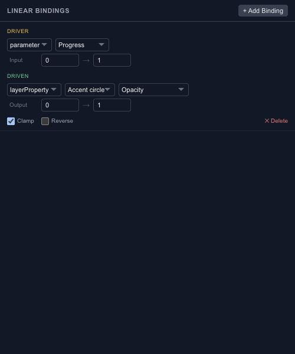

# Map parameters to motion with bindings

A binding keeps a target connected to an input. Use it when changing a parameter should continuously update a layer property or the progress of an animation.

## Choose source and target

A source can be a scene parameter or a supported layer property. The target can be a supported layer property, timeline progress or another parameter. Pick values whose meanings make sense together; a drag distance and normalized progress need a range conversion.

## Map the ranges

Set the input and output ranges, then test both ends. Clamping keeps the output inside the intended range. Reversing the mapping lets a growing input produce a decreasing output, such as fading a label while a panel opens.

For an opacity binding, compare an input at its minimum, midpoint and maximum. If a keyframe track also controls the same target, inspect the evaluated result instead of assuming the two controls simply add together.

## Keep relationships readable

Prefer one clear owner for a target value. A network of bindings is easier to debug when parameters are named by purpose and ranges are documented in the project. Use [Wires](editor-state-machines-wires.md) for a mathematical expression instead of forcing a linear mapping to do a different job.
