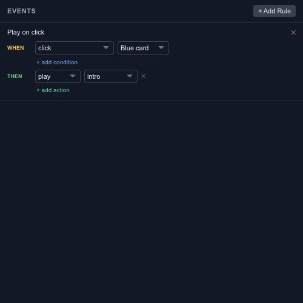

# Trigger animation actions from events

An event describes what happened. An action describes what the animation should do next. For a simple button, the event might be a click on Blue card and the action might be playing the Intro timeline.

## Choose the event source

The editor exposes click and drag events, animation lifecycle events, segment events, layer lifecycle events, markers, frame events and custom events. Choose a source layer or timeline where the event requires one.

A named source is easier to maintain than a broad rule that accidentally responds to several objects. Rename important layers before wiring their behavior.

## Add the response

Available actions include play, pause, stop, reverse, seek, play segment, set parameter and emit event. Set the target explicitly. A play action for one timeline does not imply that every timeline should restart.

When combining actions, inspect their order and avoid a custom-event chain that repeatedly triggers itself. Start with one action and add the rest after the first response works.

## Test repeated input

Try the event once, while the animation is playing, and again after it ends. Use [Runtime Preview](editor-preview.md) to check the real input path. If the response depends on a persistent state, introduce a [state machine](editor-state-machines.md) rather than adding overlapping event rules.
