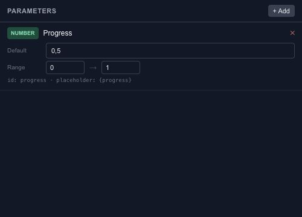

# Define parameters for interactive animation

A parameter gives an interaction a named input. Progress can represent a slider position; a boolean can represent whether a control is active. Use names that explain the meaning rather than where the value happens to be used.

## Define a useful default

Create the parameter, choose its type and set its default. For numeric values, define a range that matches the consuming behavior. A progress input commonly uses 0 to 1, while a pixel distance needs different units.

The default belongs to the saved scene. A value changed during runtime preview is a test input and should not be confused with changing the source default.

## Connect the value

Use parameters in state-machine conditions, event actions and supported property bindings. If several objects should respond together, give them the same meaningful input instead of maintaining several unrelated controls.

Test the minimum, middle and maximum values in [Preview](editor-preview.md). Use [Motion bindings](editor-state-machines-bindings.md) to map one range to another, and [Wires](editor-state-machines-wires.md) when the relationship needs an expression.
