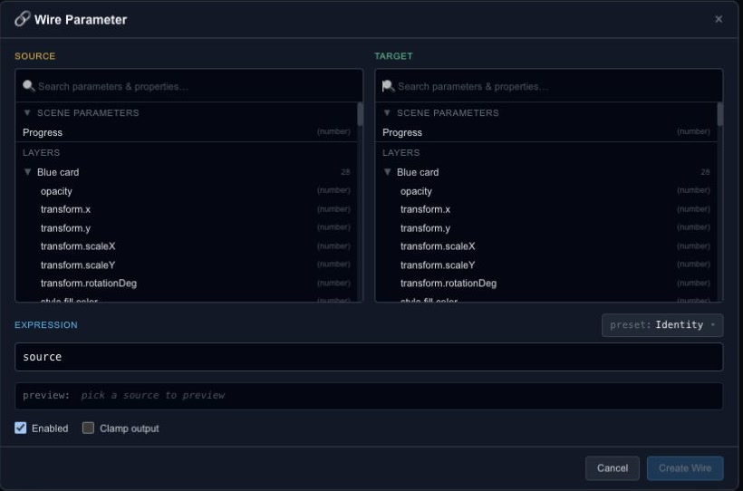

# Connect properties with parameter wires

A wire makes one value depend on another through an expression. It is useful for a relationship such as one object moving twice as far as another, or a rotation responding to a numeric control.

## Create a relationship

Open **Wires** and add a wire, or use the connection control beside a supported property. Choose the source and target, then start with the dialog's simplest expression. Preview that result before adding arithmetic.

The expression is evaluated by Chorono's supported expression system. It is not an unrestricted JavaScript console. Follow the syntax and variable names shown in the dialog, and use its validation feedback when a formula is rejected.

## Avoid conflicting drivers

Choose a target that is not already being controlled in an unexpected way by another relationship. Circular dependencies are invalid: a value cannot ultimately depend on itself through a chain of wires.

Test at more than one input value. A formula that looks correct at zero can still have the wrong scale or direction. For a simple range conversion, [Motion bindings](editor-state-machines-bindings.md) may express the intent more clearly. For time-based changes, keep using the [Timeline](editor-timeline.md).
