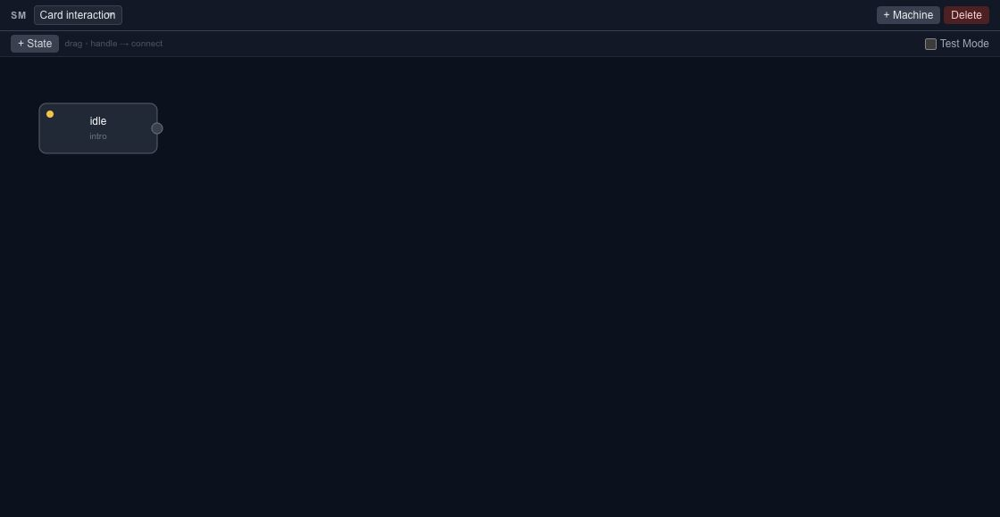

# State machines and interactions

State machines connect animation states through transitions. Use them when a scene should respond to a parameter or event, such as moving from an idle state to a confirmation animation.

## Open the state machine workspace

Switch from **Canvas** to **State Machine**, or use the toolbar's state-machine control. The timeline still owns the animation tracks; the state machine describes how states select and transition between animations.

Start with clearly named timelines and states. Keep a simple idle-to-active example before adding several transitions or conditions.

## Parameters and events

Parameters carry values used by the scene. Transitions can respond to configured conditions or events. Match names and types between the authoring setup and the host application.

The JavaScript runtime exposes `setParam(name, value)` and `dispatch(event, machineId?)`. Dispatching a name only works when the exported state machine defines the corresponding behavior. Calling a method does not create a missing transition.

## Test the interaction

1. Inspect the initial state and the animation it references.
2. Trigger the intended event or parameter change in preview.
3. Check both the transition and the final state.
4. Repeat the interaction and check how it returns to idle.
5. Export and repeat the check in the target player.

Editor and runtime releases can differ in supported features. Keep the editable source, inspect [runtime export warnings](export-runtime-json.md) and test with the exact [SDK version](runtime-downloads.md) you intend to ship.

For procedural scene changes, use the existing [scripting guide](scripting.md). For application-side playback, continue with the [JavaScript runtime](runtime-javascript.md).
