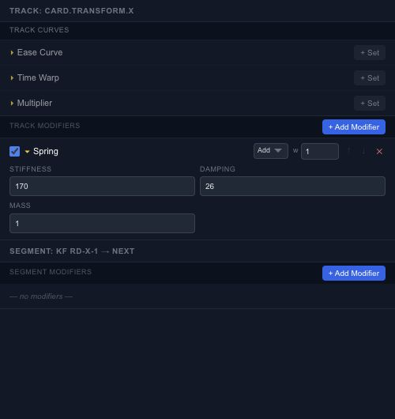

# Add procedural motion to a property track

A modifier changes the evaluated value of a track. It is useful when you want a small shake, a rhythmic pulse or a spring response without drawing every oscillation as a keyframe.

## Choose the right starting point

Use a wave or noise controller for continuously generated variation. Use keyframes when the action needs specific poses at specific times, then add modifiers to those values.

The stack includes sine, pulse, quantize, offset, scale, clamp, noise, fractal noise, jitter, wave, overshoot, elastic, bounce, decay and spring behavior. Start with a low amplitude or small offset so the original movement remains recognizable.

## Order and blending

Modifiers are evaluated in order. Clamping before adding an offset is different from clamping the final result. Choose the supported blend mode—such as add, multiply or replace—according to how the generated value should combine with the base track.

Disable an entry to compare its contribution before removing it. Inspect the beginning and end of the timeline too; a procedural motion that looks good in the middle may not make a seamless loop.

For ordinary acceleration between two keys, use the [Curve Editor](editor-timeline-curves.md) first. A modifier is useful when it expresses a repeated rule, not just because more controls are available.
