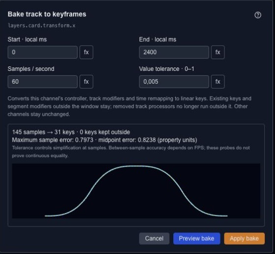

# Add procedural motion to a property track

A modifier changes the evaluated value of a track. It is useful when you want a small shake, a rhythmic pulse or a spring response without drawing every oscillation as a keyframe.

## Choose the right starting point

Use a wave or noise controller for continuously generated variation. Use keyframes when the action needs specific poses at specific times, then add modifiers to those values.

The stack includes sine, pulse, quantize, offset, scale, clamp, noise, fractal noise, jitter, wave, overshoot, elastic, bounce, decay and spring behavior. Start with a low amplitude or small offset so the original movement remains recognizable.

## Order and blending

Modifiers are evaluated in order. Clamping before adding an offset is different from clamping the final result. Choose the supported blend mode—such as add, multiply or replace—according to how the generated value should combine with the base track.

Disable an entry to compare its contribution before removing it. Inspect the beginning and end of the timeline too; a procedural motion that looks good in the middle may not make a seamless loop.

For ordinary acceleration between two keys, use the [Curve Editor](editor-timeline-curves.md) first. A modifier is useful when it expresses a repeated rule, not just because more controls are available.

## Preview procedural animation curves

A controller can produce motion even when its track has no native keyframes. The Curve Editor displays that evaluated signal without adding keys to the project. For a sine controller, frequency is in hertz, phase is in radians and the track uses local timeline time in milliseconds. An offset of 100, amplitude of 50, frequency of `1 / pi` and phase of 0 gives the same signal as `100 + 50 * sin(2 * timeSec)`.

## Bake a property track to keyframes

Baking samples procedural motion and turns it into editable keyframes. Use it when you want to edit the result directly or prepare a channel for a target that cannot run its controller.

1. Open **Bake Track to Keyframes** for the property track.
2. Set the start and end in local timeline milliseconds, the samples per second and the tolerance.
3. Choose **Preview bake**. Compare the source and baked curves and read the reported errors.
4. Choose **Apply bake** to commit the result as one Undo step.

The bake includes the channel's controller, track modifiers and time remapping. Keys and segment modifiers outside the selected window stay. Removed track processors stop running everywhere on the track, so inspect motion outside that window too. Other channels are unchanged.

## Bake a live expression to keyframes

Open the property's saved live formula and choose **Bake to keyframes…**. Set the range in **project milliseconds**, preview, then apply. This creates keys on a new composition-time timeline and removes that property's live driver. Current parameter values are captured at preview time; the resulting keys no longer respond to later parameter changes.

Numbers, colors and points use linear keyframe interpolation. Boolean and text values use hold keys. Before and after the sampled range, the first and last baked values hold. Other channels and the authored fallback are preserved. A formula whose timeline clock is owned by a state machine cannot use this bake workflow.

## Choose sampling and tolerance

Start with a sample rate that captures the fastest change you need to keep. Tolerance is a fraction of the sampled value span and controls key reduction. Reported errors use the target property's units; color error is the largest RGBA channel difference, and point error is the largest local X/Y difference. Discrete values report a 0/1 mismatch instead of a continuous tolerance.

Sample and midpoint checks help you judge the approximation, but cannot prove equality between every pair of samples. Increase the sample rate for fast oscillations or sudden changes and check the final playback. Preview does not edit source data, cancelling adds no history, and a source change invalidates the preview. Review again before applying.

See [property formulas](editor-properties.md#animation-expressions-and-formulas) for expression types and [runtime JSON](export-runtime-json.md) for target-specific export checks.
