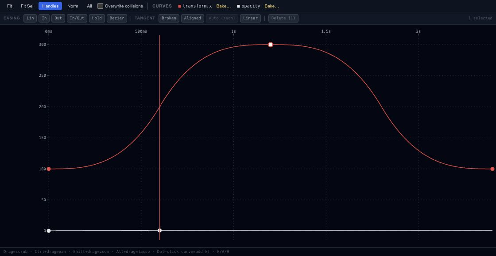

# Shape animation easing in the Curve Editor

The Curve Editor explains how a property changes between keys. Time runs horizontally and the property value runs vertically. A steep section changes quickly; a flat section changes slowly or holds still.

## Start with one track

Select a layer and the property you want to inspect. Fit the curve into view, then play the animation once before changing it. This makes it easier to connect the shape of the curve with the movement you see.

Move a key to adjust its time and value. Use the easing controls or tangent handles where the chosen interpolation supports them. For a gentle arrival, reduce the rate of change near the ending key rather than adding several almost-identical keys.

## Tangents and holds

Linear interpolation gives a steady change between keys. A hold keeps the value until the next change. Custom Bézier easing gives more control over the transition. Tangent options depend on the selected curve and key; a disabled option is not an active editing mode.

Check neighboring keys after changing a handle. A smooth-looking segment can still introduce an unwanted overshoot. For repeating noise, springs or other procedural variation, continue with [Controllers & modifiers](editor-timeline-controllers.md).
