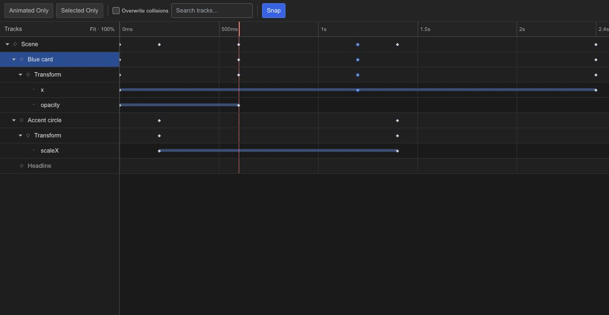

# Adjust animation timing in the Dope Sheet

The Dope Sheet shows when changes happen. Each keyframe is a time marker on a track, so it is a good place to make several objects arrive together or spread their entrances apart.

## Read the rows

Expand a layer to see its animated properties. Scrub the time ruler to compare a key with the visible result. The same keyframes also appear in the Timeline and Curve Editor; switching views does not create another animation.

## Move a beat

Select the keys that belong to one action and drag them together. Use snapping when they should land on a consistent time interval. Zoom in before adjusting a short gap so that a small pointer movement does not shift the timing too far.

Keep the keys that define an action together unless you deliberately want to stretch it. Moving only an ending key changes the duration; moving both ends preserves it.

## Timing or easing?

Use this view for the timing of an action. Open the [Curve Editor](editor-timeline-curves.md) when the start and end times are correct but the acceleration feels wrong. Use the [Spreadsheet](editor-keyframes-spreadsheet.md) when you know the exact time or value you want.
