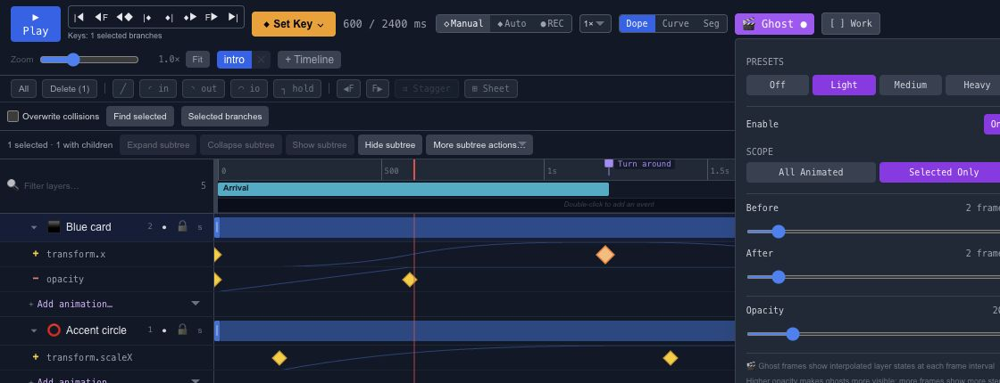

# Compare animation poses with onion skinning

Onion skinning shows neighboring poses alongside the current one. In Chorono, the **Ghost** controls help you judge spacing, arcs and overlap without repeatedly moving the playhead back and forth.

## Turn on Ghost

Enable Ghost from the timeline toolbar. Choose the scope and sample settings that match the question you are trying to answer. A few nearby poses are often enough to see whether an object speeds up smoothly.

Use a restrained opacity so the current pose stays readable. When the view becomes crowded, reduce the number of samples or narrow the time range.

## Read the spacing

Evenly spaced poses indicate a fairly steady movement. Poses packed together near the end usually mean the object is slowing down. A sharp change in the path may indicate an intentional corner or an unwanted change between keys.

Ghosts are an editing aid. Check normal playback afterward, because the viewer will see one frame at a time. For changing the motion itself, use [Motion Keys](editor-canvas-motion-keys.md) or the [Curve Editor](editor-timeline-curves.md).
