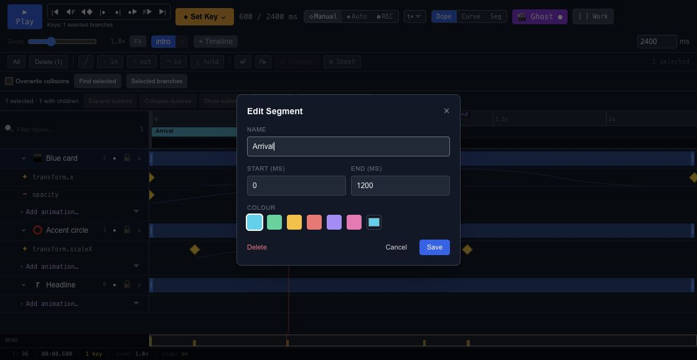

# Organize a timeline with segments and markers

Use a segment for a meaningful range such as an entrance, a hover response or an exit. Use a marker for a particular moment, such as the point where an icon changes direction.

## Name a range

Create a segment and set its start and end times. Give it a name that describes the action rather than its position in the project. Keep the range inside the timeline's duration and preview both boundaries.

A segment does not create a separate copy of the keys. It refers to a range in the existing timeline. Editing those keys also changes the movement inside the segment.

## Mark an important instant

Add a marker at the playhead and give it a useful label. Markers help you return to a visual beat without remembering a millisecond value. They can also be used by the event system when an action should happen at that point.

## Play a range through interaction

Use a play-segment action in [Events](editor-state-machines-events.md) when an input should run only one part of the timeline. Check repeated inputs and the end of the range in [Preview](editor-preview.md), especially when the same timeline contains several responses.
