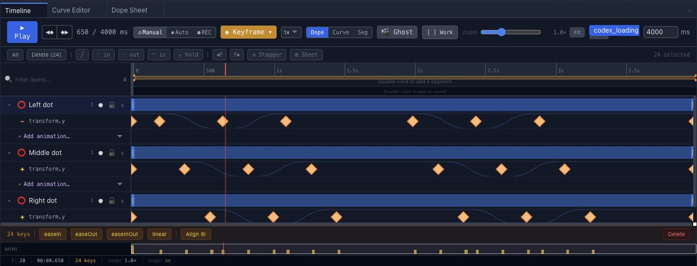
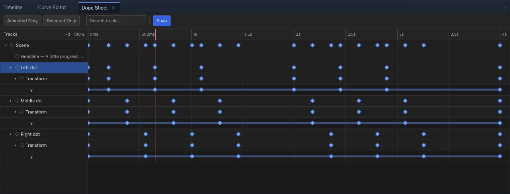
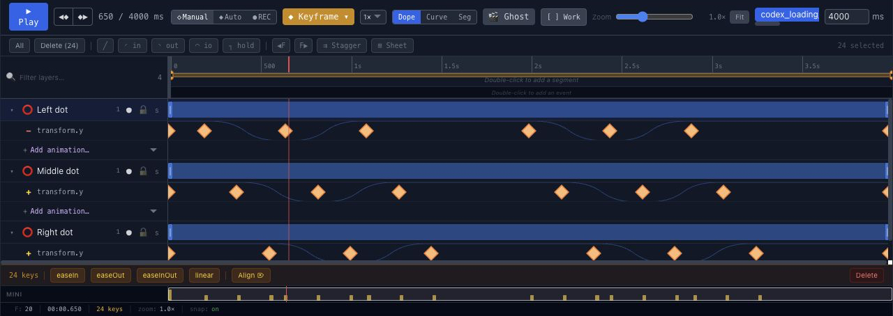

# Work with the animation timeline

Use the timeline to see when a property changes, scrub through intermediate frames and compare the movement with its stored keyframes.

## Read tracks and keyframes

A track animates one property on a layer. A keyframe stores its value at a specific time. A title can have separate tracks for vertical position and opacity, even when both changes feel like one entrance.

Open [Your first animation](getting-started.md), select the `first-animation` timeline and inspect a named layer. This example contains 13 tracks across eight layers.

For the component screenshots below, open the simpler [three-dot loading project](loop-animation.md#open-the-example). Its three animated dot layers each have one vertical-position track.

## Scrub the playhead

Move the playhead, the marker for the current time, to inspect a frame without playing the whole scene. Compare the beginning, a midpoint and the final state of a movement. Play the sequence too: a single still frame cannot show its rhythm.

## Compare timing in the Dope Sheet

Choose the **Dope Sheet** tab in the bottom dock. This is a separate panel from the **Dope** display button inside Timeline.

Expand a layer, then **Transform → y**, to see the property's keyframes. Scene and layer rows summarize their child keys; the property row shows the individual channel. Compare the offset peaks across the three dots before moving keys.

Use **Search tracks** to narrow the rows. **Animated Only** hides rows without animation, while **Selected Only** limits the view to the selected layer. Check **Snap** before dragging keys. Keep the original 180 ms stagger when following the loading-loop tutorial.

## Understand frames and milliseconds

Chorono's scene data and scripting times use milliseconds. 1000 ms is one second. At 30 frames per second, neighboring frames are approximately 33.33 ms apart. A four-second composition spans 120 frame intervals at that frame rate.

Changing the time of an end keyframe changes the duration of that movement. Changing its value changes the endpoint. Frame rate and movement duration are separate decisions.

## Choose a timeline explicitly

A scene can contain multiple timelines. Name the timeline you intend to edit in an agent brief. In a script, `scene.useTimeline(id)` selects the timeline for subsequent layer key operations; `Timeline.key` always targets its own timeline.

Timeline names such as intro, idle and outro do not automatically sequence those animations. Use explicit keyframe times for a continuous sequence, or verified interaction definitions for state transitions. See [JavaScript scene scripting](scripting.md).

## Check looping playback

A repeating timeline must join its end back to its beginning as intended. Inspect the frames before and after the wrap. Matching positions alone does not guarantee matching speed.

Follow [Looping animations](loop-animation.md) to inspect a four-second scene with a resting interval at its boundary. Save and reopen your edited project before treating the revision as complete.

