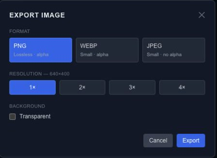

# Export images, SVG and frame sequences

Use a still image for a single frame, SVG for supported vector content or a numbered image sequence for a video-production pipeline. Each format has different transparency and feature support.

## Still images

Move the playhead to the frame you want, then choose **Export → Image (PNG / WEBP / JPEG)**. Select the format, resolution scale and background options shown by the dialog.

| Format | Typical use | Transparency |
| --- | --- | --- |
| PNG | Lossless stills, logos and overlays | Supported |
| WebP | Web images | Supported by the export format |
| JPEG | Photographic stills with a background | No alpha channel; transparent output is flattened |

Check the actual downloaded image at full size. The canvas zoom level does not set the output resolution. Scaling both dimensions increases the number of pixels and the work required to render them.

## SVG

Choose **Export → SVG (vector)**. The exporter covers supported shapes, paths, text and groups. Images, video, particles and effects are skipped and reported in warnings.

Static SVG captures the current frame. **Animated (SMIL)** maps supported transform and opacity tracks to self-playing, looping SVG animation. It does not convert the entire interactive scene or every effect into SVG.

Inspect the result in the intended browser or design tool and review every skipped item. Use raster output when the required appearance cannot be represented by the SVG exporter.

## Image sequences

Choose **Export → Image Sequence (ZIP)** and set the frame format, FPS, resolution scale and background. The editor renders numbered frames and packages them into a ZIP, reporting progress during rendering.

For a four-second animation at 30 FPS, expect about 120 frames. Higher frame rates, longer scenes and larger dimensions increase output size and processing work. Check the first and last frames after extracting the ZIP.

A frame sequence contains images, not an encoded video or mixed audio track. Import the frames into your video tool at the same FPS used for export and manage audio there.

## Keep the source

An image or SVG is not a substitute for the [editable project](export-project-json.md). Save the source first so you can change text, timing or dimensions later. For application playback, use [runtime JSON](export-runtime-json.md).

## Match export to the full composition

Raster output uses the full composition and original sources, independently of canvas pan, zoom, isolation and level-of-detail previews. Output preparation and drawing use the same parameter snapshot. Pending media, fonts or video frames must finish preparing; a preparation failure is reported instead of being treated as a successful blank frame.

PNG and WebP support transparent output. JPEG has no alpha channel; transparent output is flattened onto white with a warning. Inspect the exported file, especially soft edges and shadows.

Resolution scales above 1× currently upscale the rendered bitmap. They do not rerender vector geometry at a higher resolution or provide an advanced-color/FP16 pipeline. Set suitable composition dimensions before exporting when native pixel detail matters.
